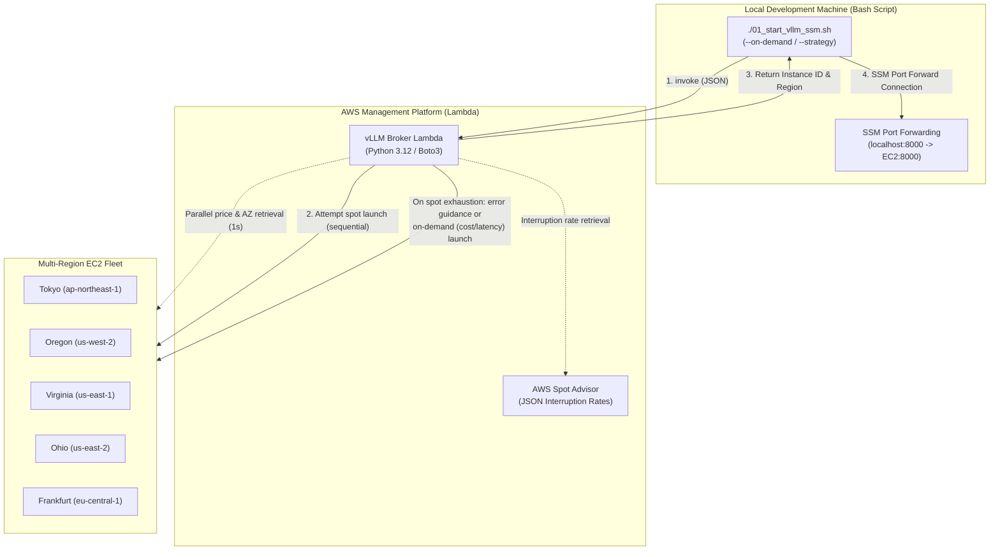

## Introduction

This is a technical validation log where I transform spontaneous ideas and intriguing cloud technologies into tangible form through hands-on experimentation, guided purely by curiosity.

In the previous article ([Securing EC2 Spot × vLLM with SSM! Connecting with Zero Port Openings](/blogs/2026/10/09/vllm_ssm_zero_inbound/)), I introduced AWS Systems Manager (SSM) Session Manager for port forwarding, establishing a secure GPU usage environment that completely closes inbound security group rules (zero port openings) and fully eliminates SSH key management.

However, as I added features in Part 3 and Part 4, new operational challenges emerged in the client-side (WSL/Mac, etc.) launch script (Bash):

1. Slow search latency (limits of sequential processing):  
  Because the Bash script used the AWS CLI to fetch spot prices, AZ candidates, and Spot Advisor interruption rates for multiple regions sequentially, the search and scoring alone could take nearly 15–30 seconds.  
2. Handling spot depletion (complete exhaustion):  
  Due to the global AI boom, at certain times spot capacity in candidate regions could become completely depleted (`InsufficientInstanceCapacity`). In such cases, the script would stop with an error, requiring a manual relaunch of on-demand instances and causing extra work.  
3. Local environment bloat and maintainability:  
  The Bash script was packed with price parsing, interruption rate calculation, JSON manipulation, and AWK-based scoring logic, pushing shell script maintainability to its limits.

This time, to bring to life the idea of “wouldn't it be cool to create a serverless API in the cloud that automatically discovers and launches the cheapest spot GPUs around the world in parallel and at high speed?”, I completely decoupled these decision and search logics from the client, evolving into a **Serverless GPU Broker** using AWS Lambda.

I will introduce a practical method that implements high-speed parallel multi-region, multi-AZ scanning (completing in around 1 second) using Python’s `concurrent.futures`, along with a smart **on-demand fallback feature** for spot depletion.

:::info
**📚 Related Previous Validation Articles**
* **Part 1 (Basic Setup)**: [Auto-launching vLLM with AWS×UserData! A Local LLM Environment with Almost Zero Idle Cost](/blogs/2026/09/16/vllm_autolaunch/)
* **Part 2 (Cline Integration)**: [Connecting Self-Hosted vLLM to VS Code (Cline) via Open WebUI! Token-Free Development](/blogs/2026/09/29/vllm_openwebui_cline/)
* **Part 3 (Spot Utilization)**: [Significantly Cutting GPU Costs with EC2 Spot Instances × vLLM](/blogs/2026/10/02/vllm_spot_instance/)
* **Part 4 (SSM Securing)**: [Securing EC2 Spot × vLLM with SSM! Connecting with Zero Inbound Ports](/blogs/2026/10/09/vllm_ssm_zero_inbound/)
:::

---

## Architecture of the Serverless GPU Broker

> **📌 Key Points of This Section**  
> The client is freed from search and decision logic, shifting to a simple setup of “invoking Lambda and receiving launch results.” On the Lambda side, it handles multi-region Boto3 parallel queries, aggregate scoring, spot launch attempts, and on-demand fallback all in one.



### Architecture Evolution Points

| Item                          | Configuration up to Part 4 (Client Bash)                                     | This Configuration (Lambda Broker)                              | Benefits                                            |
|-------------------------------|------------------------------------------------------------------------------|-----------------------------------------------------------------|-----------------------------------------------------|
| **Search Speed**              | Over 15–30 seconds (CLI executed sequentially)                                | **About 1–2 seconds (Python thread parallel)**                 | Drastically reduced waiting time                    |
| **Client Responsibilities**   | Fetching prices & interruption rates, search calculation, launch attempts     | **Lambda invocation and SSM tunnel connection only**           | Freed from complex search logic                     |
| **On Spot Exhaustion**        | Interrupted with error, manual handling                                       | **Clear error guidance & on-demand switch**                    | Recoverable without stopping development work       |
| **Normal Launch Strategy**    | None                                                                         | **“Cheapest Cost” or “Lowest Latency”**                        | Flexible choice based on business priorities        |

---

## Fallback Design for Spot Exhaustion

Since spot instances use surplus capacity, during peak global GPU demand you may encounter “spot exhaustion” where all candidate regions return `InsufficientInstanceCapacity`.

This system adopts the following two-tier fallback policy:

1. **Default (Spot Launch)**:  
   Attempts spot launch in all candidate regions, and if all are out of stock, immediately returns the error `ALL_SPOT_EXHAUSTED`. The error message clearly guides users to retry with the on-demand option (`--on-demand`). This prevents accidental on-demand charges and unexpected expenses.  
2. **On-Demand Specified (`--on-demand`)**:  
   If you need to proceed immediately, explicitly specify the `--on-demand` flag and re-run. At that point, you can choose one of two strategies (`--strategy`):  
   - **`cost` (cheapest cost priority, default)**: Compares on-demand list prices (converted to USD) across all regions, including overseas, and launches in the region with the lowest list price.  
   - **`latency` (low latency priority)**: Prioritizes the physically closest Tokyo region (`ap-northeast-1`) to ensure responsive typing and comfortable interaction.

---

## Lambda Function Implementation (`handler.py`)

This is the core logic of the Lambda function. It completes the entire process using only the standard library (`concurrent.futures`, `urllib.request`) and `boto3`, without external dependencies.

:::info
**💡 Clever Point: Externalizing UserData to S3 and 3-Line Bootstrap**  
In this implementation, the lengthy Bash script for initialization (NVMe mounting, Docker data relocation, parallel sync, vLLM launch, idle auto-shutdown) is **externalized to S3 (`s3://${S3_BUCKET}/scripts/startup.sh`)**.

By limiting the UserData passed to EC2 to just three lines that fetch and execute the script from S3, you get:
* **Significantly slimmed-down Lambda code**: Eliminates the over-100-line Bash here-document, improving overall readability.  
* **Faster iteration**: To tweak the startup script, update the S3 script without rebuilding or redeploying the Lambda function for immediate effect.  
* **Avoidance of the 16KB UserData limit**: No matter how large the script grows, you never hit the EC2 UserData size limit.
:::

<details><summary>handler.py (click to expand)</summary>

```python
"""
vLLM GPU Spot Broker Lambda
A serverless broker that orchestrates multi-region spot discovery, optimal region selection, spot launch, and termination
"""

import json
import logging
import urllib.request
import concurrent.futures
import boto3
from botocore.config import Config

import os

logger = logging.getLogger()
logger.setLevel(logging.INFO)

# Candidate regions and instance type
env_regions = os.environ.get("TARGET_REGIONS")
CANDIDATE_REGIONS = [r.strip() for r in env_regions.split(",") if r.strip()] if env_regions else ["ap-northeast-1", "eu-central-1", "us-east-2", "us-east-1", "us-west-2"]
INSTANCE_TYPE = os.environ.get("INSTANCE_TYPE", "g6.xlarge")
IAM_ROLE_NAME = os.environ.get("INSTANCE_PROFILE_NAME", "vllm-ssm-instance-profile")
TAG_SERVER_NAME = os.environ.get("TAG_SERVER_NAME", "vllm-ssm-spot-node")
S3_BUCKET_NAME = os.environ.get("S3_BUCKET_NAME", "vllm-models-storage")
ECR_REPOSITORY_NAME = os.environ.get("ECR_REPOSITORY_NAME", "vllm-openai")

# Region-specific AMI ID cache (Ubuntu 22.04 Deep Learning AMI)
AMI_MAPPING = {
    "ap-northeast-1": "ami-0152728adca68ed36",
    "eu-central-1": "ami-0efde0090dab8cacf",
    "us-east-2": "ami-032b37e4db407994d",
    "us-east-1": "ami-012ba162b9cd2729c",
    "us-west-2": "ami-0ca70308d230e8a6e",
}

# On-demand reference prices ($/h: g6.xlarge) and approximate RTT from Tokyo (ms)
ON_DEMAND_METRICS = {
    "ap-northeast-1": {"price": 1.3412, "latency_ms": 15, "name": "Tokyo (Lowest latency, domestic)"},
    "us-west-2":      {"price": 0.9840, "latency_ms": 110, "name": "Oregon (Cheapest cost, moderate latency)"},
    "us-east-2":      {"price": 0.9840, "latency_ms": 150, "name": "Ohio (Cheapest cost)"},
    "us-east-1":      {"price": 0.9840, "latency_ms": 170, "name": "Virginia (Cheapest cost)"},
    "eu-central-1":   {"price": 1.2024, "latency_ms": 230, "name": "Frankfurt"},
}

# S3-externalized bootstrap UserData (main script fetched quickly from s3://.../scripts/startup.sh)
USERDATA_BOOTSTRAP = """#!/bin/bash
set -euo pipefail
LOG_FILE="/var/log/userdata-bootstrap.log"
exec > >(tee -a "${LOG_FILE}" | logger -t user-data -s 2>/dev/console) 2>&1

AWS_REGION="__AWS_REGION__"
S3_BUCKET="__S3_BUCKET_NAME__"
DOCKER_IMAGE="__DOCKER_IMAGE__"

echo "=== Fetching startup script (startup.sh) from S3 ==="
aws s3 cp "s3://${S3_BUCKET}/scripts/startup.sh" /tmp/startup.sh --region "${AWS_REGION}"
chmod +x /tmp/startup.sh

echo "=== Executing startup.sh ==="
/tmp/startup.sh "${AWS_REGION}" "${S3_BUCKET}" "${DOCKER_IMAGE}"
"""


def get_spot_advisor_data():
    """Get interruption frequency tiers from Spot Advisor"""
    url = "https://spot-bid-advisor.s3.amazonaws.com/spot-advisor-data.json"
    tiers = {}
    try:
        req = urllib.request.Request(url, headers={"User-Agent": "Lambda-Broker"})
        with urllib.request.urlopen(req, timeout=3) as res:
            adv = json.loads(res.read().decode("utf-8")).get("spot_advisor", {})
            for r, info in adv.items():
                tier = info.get("Linux", {}).get(INSTANCE_TYPE, {}).get("r", 4)
                tiers[r] = tier
    except Exception as e:
        logger.warning(f"Failed to retrieve Spot Advisor data: {e}")
    return tiers


def query_region_metrics(region, advisor_tiers):
    """Retrieve spot price and AZ count for a single region"""
    boto_cfg = Config(connect_timeout=2, read_timeout=3, retries={"max_attempts": 1})
    ec2 = boto3.client("ec2", region_name=region, config=boto_cfg)
    try:
        res = ec2.describe_spot_price_history(
            InstanceTypes=[INSTANCE_TYPE],
            ProductDescriptions=["Linux/UNIX"],
            MaxResults=10,
        )
        prices = res.get("SpotPriceHistory", [])
        if not prices:
            return None

        # Minimum price and AZ count
        min_price = min(float(p["SpotPrice"]) for p in prices)
        azs = set(p["AvailabilityZone"] for p in prices)
        az_count = len(azs)
        tier = advisor_tiers.get(region, 4)

        return {
            "region": region,
            "min_price": min_price,
            "az_count": az_count,
            "tier": tier,
        }
    except Exception as e:
        logger.error(f"Error querying {region}: {e}")
        return None


def select_best_region():
    """Evaluate all candidate regions in parallel and determine the best region"""
    advisor_tiers = get_spot_advisor_data()
    metrics = []

    with concurrent.futures.ThreadPoolExecutor(max_workers=len(CANDIDATE_REGIONS)) as executor:
        futures = {executor.submit(query_region_metrics, r, advisor_tiers): r for r in CANDIDATE_REGIONS}
        for future in concurrent.futures.as_completed(futures):
            res = future.result()
            if res:
                metrics.append(res)

    if not metrics:
        raise RuntimeError("Failed to retrieve spot prices for all regions")

    best_price = min(m["min_price"] for m in metrics)

    # Score calculation: Price 40 + Excess AZ 40 + Interruption tolerance 20
    best_item = None
    max_score = -1

    for m in metrics:
        p_score = int(40.0 * (best_price / m["min_price"]))

        tier = m["tier"]
        i_score = {0: 20, 1: 15, 2: 10, 3: 5}.get(tier, 0)

        az = m["az_count"]
        if az >= 5:
            c_score = 40
        elif az == 4:
            c_score = 32
        elif az == 3:
            c_score = 24
        elif az == 2:
            c_score = 16
        else:
            c_score = 8

        total_score = p_score + i_score + c_score
        m["score"] = total_score
        if total_score >= 75:
            m["rank"] = "Rank S"
        elif total_score >= 65:
            m["rank"] = "Rank A"
        elif total_score >= 50:
            m["rank"] = "Rank B"
        else:
            m["rank"] = "Rank C"

        if total_score > max_score:
            max_score = total_score
            best_item = m

    return best_item, metrics


def get_or_create_ssm_security_group(ec2_client, region):
    """SSM-only security group with zero inbound rules (completely closed)"""
    sg_name = "vllm-ssm-isolated-sg"
    try:
        res = ec2_client.describe_security_groups(
            Filters=[{"Name": "group-name", "Values": [sg_name]}]
        )
        if res["SecurityGroups"]:
            return res["SecurityGroups"][0]["GroupId"]
    except Exception:
        pass

    # Create in default VPC
    vpcs = ec2_client.describe_vpcs(Filters=[{"Name": "isDefault", "Values": ["true"]}])["Vpcs"]
    vpc_id = vpcs[0]["VpcId"] if vpcs else ec2_client.describe_vpcs()["Vpcs"][0]["VpcId"]

    new_sg = ec2_client.create_security_group(
        GroupName=sg_name,
        Description="Zero inbound ports allowed - access exclusively via AWS Systems Manager (SSM)",
        VpcId=vpc_id,
    )
    # Do not add any inbound rules (completely closed)
    return new_sg["GroupId"]


def get_latest_dlami(ec2_client):
    """Dynamically retrieve the latest Ubuntu 22.04 Deep Learning AMI ID"""
    try:
        res = ec2_client.describe_images(
            Owners=["amazon"],
            Filters=[{"Name": "name", "Values": ["Deep Learning OSS Nvidia Driver AMI GPU PyTorch 2.* (Ubuntu 22.04)*"]}],
        )
        images = sorted(res.get("Images", []), key=lambda x: x["CreationDate"])
        if images:
            return images[-1]["ImageId"]
    except Exception as e:
        logger.warning(f"Failed to query latest DLAMI: {e}")
    return None


def select_on_demand_region(strategy="cost"):
    """Select the best region for standard launch (on-demand)
    - cost: Region with the lowest on-demand price (if same price, prefers lower latency: us-west-2 > us-east-2 > us-east-1)
    - latency: Region with the lowest latency from Tokyo (prioritize ap-northeast-1)
    """
    valid_regions = [r for r in CANDIDATE_REGIONS if r in ON_DEMAND_METRICS]
    if not valid_regions:
        valid_regions = CANDIDATE_REGIONS

    if strategy == "latency":
        return sorted(valid_regions, key=lambda r: ON_DEMAND_METRICS.get(r, {}).get("latency_ms", 999))
    else:
        return sorted(
            valid_regions,
            key=lambda r: (
                ON_DEMAND_METRICS.get(r, {}).get("price", 999),
                ON_DEMAND_METRICS.get(r, {}).get("latency_ms", 999),
            ),
        )


def launch_instance(region, account_id, is_spot=True):
    """Launch an instance (spot or on-demand) in the specified region"""
    ec2 = boto3.client("ec2", region_name=region, config=Config(retries={"max_attempts": 1}))

    ami_id = AMI_MAPPING.get(region)
    if not ami_id:
        ami_id = get_latest_dlami(ec2)
        if not ami_id:
            raise ValueError(f"AMI ID not configured for region {region}")

    sg_id = get_or_create_ssm_security_group(ec2, region)

    s3_bucket = S3_BUCKET_NAME
    if not s3_bucket or s3_bucket == "vllm-models-storage" or "*" in s3_bucket:
        s3_bucket = f"my-vllm-models-hackathon-2026-{account_id}-{region}-an"
    elif "{account_id}" in s3_bucket or "{region}" in s3_bucket:
        s3_bucket = s3_bucket.replace("{account_id}", account_id).replace("{region}", region)

    docker_image = f"{account_id}.dkr.ecr.{region}.amazonaws.com/{ECR_REPOSITORY_NAME}:latest"

    # Generate UserData (S3-externalized bootstrap)
    userdata_script = USERDATA_BOOTSTRAP.replace("__AWS_REGION__", region)
    userdata_script = userdata_script.replace("__S3_BUCKET_NAME__", s3_bucket)
    userdata_script = userdata_script.replace("__DOCKER_IMAGE__", docker_image)

    def do_run(target_ami):
        run_params = {
            "ImageId": target_ami,
            "InstanceType": INSTANCE_TYPE,
            "MinCount": 1,
            "MaxCount": 1,
            "IamInstanceProfile": {"Name": IAM_ROLE_NAME},
            "SecurityGroupIds": [sg_id],
            "InstanceInitiatedShutdownBehavior": "terminate",
            "BlockDeviceMappings": [
                {
                    "DeviceName": "/dev/sda1",
                    "Ebs": {
                        "VolumeSize": 40,
                        "VolumeType": "gp3",
                        "DeleteOnTermination": True,
                    },
                }
            ],
            "UserData": userdata_script,
            "TagSpecifications": [
                {
                    "ResourceType": "instance",
                    "Tags": [
                        {"Key": "Name", "Value": TAG_SERVER_NAME},
                        {"Key": "Project", "Value": "vllm-ephemeral"},
                        {"Key": "MarketType", "Value": "spot" if is_spot else "on-demand"},
                    ],
                }
            ],
        }

        if is_spot:
            run_params["InstanceMarketOptions"] = {
                "MarketType": "spot",
                "SpotOptions": {
                    "SpotInstanceType": "one-time",
                    "InstanceInterruptionBehavior": "terminate",
                },
            }

        return ec2.run_instances(**run_params)

    try:
        run_res = do_run(ami_id)
    except Exception as e:
        if "InvalidAMIID" in str(e):
            logger.info(f"AMI {ami_id} invalid in {region}, querying latest dynamically...")
            dynamic_ami = get_latest_dlami(ec2)
            if dynamic_ami and dynamic_ami != ami_id:
                run_res = do_run(dynamic_ami)
            else:
                raise
        else:
            raise

    instance_id = run_res["Instances"][0]["InstanceId"]
    return instance_id


def launch_spot_instance(best_region_info, account_id):
    """Backward compatibility alias"""
    return launch_instance(best_region_info["region"], account_id, is_spot=True)


def terminate_all_instances():
    """Search and terminate running vLLM instances (spot or on-demand) across all candidate regions"""
    terminated = []

    def check_and_term(region):
        ec2 = boto3.client("ec2", region_name=region)
        try:
            res = ec2.describe_instances(
                Filters=[
                    {"Name": "tag:Name", "Values": [TAG_SERVER_NAME]},
                    {"Name": "instance-state-name", "Values": ["pending", "running", "stopping"]},
                ]
            )
            ids = [i["InstanceId"] for r in res.get("Reservations", []) for i in r.get("Instances", [])]
            if ids:
                ec2.terminate_instances(InstanceIds=ids)
                return [{"region": region, "instance_id": i} for i in ids]
        except Exception as e:
            logger.error(f"Error terminating in {region}: {e}")
        return []

    with concurrent.futures.ThreadPoolExecutor(max_workers=len(CANDIDATE_REGIONS)) as executor:
        results = executor.map(check_and_term, CANDIDATE_REGIONS)
        for r_list in results:
            terminated.extend(r_list)

    return terminated


def terminate_all_spot_instances():
    """Backward compatibility alias"""
    return terminate_all_instances()


def lambda_handler(event, context):
    """Lambda main entry point"""
    action = event.get("action", "launch")
    mode = event.get("mode", "spot")  # "spot" or "on-demand"
    if event.get("on_demand") is True or event.get("use_on_demand") is True:
        mode = "on-demand"
    strategy = event.get("strategy", "cost").lower()  # "cost" or "latency"

    account_id = context.invoked_function_arn.split(":")[4]

    logger.info(f"Received action: {action}, mode: {mode}, strategy: {strategy} (Account: {account_id})")

    if action == "launch":
        if mode == "on-demand":
            # On-demand launch
            candidates = select_on_demand_region(strategy)
            logger.info(f"On-Demand candidate order (strategy={strategy}): {candidates}")

            failed_attempts = []
            last_error = None

            for region in candidates:
                info = ON_DEMAND_METRICS.get(region, {"price": 1.0, "latency_ms": 100, "name": region})
                logger.info(f"Attempting On-Demand launch in {region} ({info.get('name')})...")
                try:
                    instance_id = launch_instance(region, account_id, is_spot=False)
                    logger.info(f"Successfully launched On-Demand instance {instance_id} in {region}")
                    return {
                        "status": "success",
                        "action": "launch",
                        "market_type": "on-demand",
                        "strategy": strategy,
                        "region": region,
                        "region_name": info.get("name"),
                        "instance_id": instance_id,
                        "instance_type": INSTANCE_TYPE,
                        "on_demand_price": info.get("price"),
                        "latency_ms": info.get("latency_ms"),
                        "fallback_attempts": failed_attempts,
                        "note": f"Launched with standard on-demand (priority strategy: {strategy}).",
                    }
                except Exception as e:
                    err_str = str(e)
                    if "VcpuLimitExceeded" in err_str or "InstanceLimitExceeded" in err_str:
                        reason = "On-demand GPU quota limit reached"
                    else:
                        reason = f"{type(e).__name__}"
                    logger.warning(f"On-Demand launch failed in {region} ({reason})")
                    failed_attempts.append({"region": region, "reason": reason})
                    last_error = e
                    continue

            return {
                "status": "error",
                "error_code": "ALL_ON_DEMAND_FAILED",
                "message": f"Failed to launch in all on-demand candidate regions. Last error: {last_error}",
                "fallback_attempts": failed_attempts,
            }

        else:
            # Default: Spot launch
            _, all_metrics = select_best_region()
            sorted_candidates = sorted(all_metrics, key=lambda x: x.get("score", 0), reverse=True)
            logger.info(f"Ranked spot candidates: {[c['region'] for c in sorted_candidates]}")

            failed_attempts = []
            last_error = None
            for candidate in sorted_candidates:
                region = candidate["region"]
                logger.info(f"Attempting spot launch in {region} (Score: {candidate.get('score')}, Rank: {candidate.get('rank')})...")
                try:
                    instance_id = launch_instance(region, account_id, is_spot=True)
                    logger.info(f"Successfully launched spot instance {instance_id} in {region}")
                    return {
                        "status": "success",
                        "action": "launch",
                        "market_type": "spot",
                        "region": region,
                        "instance_id": instance_id,
                        "instance_type": INSTANCE_TYPE,
                        "spot_price": candidate.get("min_price"),
                        "score": candidate.get("score"),
                        "rank": candidate.get("rank"),
                        "candidates": all_metrics,
                        "fallback_attempts": failed_attempts,
                    }
                except Exception as e:
                    err_str = str(e)
                    if "InsufficientInstanceCapacity" in err_str:
                        reason = "Spot capacity shortage (out of stock)"
                    elif "MaxSpotInstanceCountExceeded" in err_str:
                        reason = "Spot quota limit reached"
                    else:
                        reason = f"{type(e).__name__}"
                    logger.warning(f"Spot launch failed in {region} ({reason}), trying next candidate...")
                    failed_attempts.append({
                        "region": region,
                        "score": candidate.get("score"),
                        "rank": candidate.get("rank"),
                        "reason": reason,
                    })
                    last_error = e
                    continue

            # All regions exhausted: error response
            return {
                "status": "error",
                "error_code": "ALL_SPOT_EXHAUSTED",
                "message": (
                    "Failed to launch spot instances in all candidate regions (capacity shortage, etc.).\n"
                    "To launch on-demand, specify the '--on-demand' option and retry.\n"
                    "  e.g.: ./01_start_vllm_ssm.sh --on-demand --strategy cost     # Cheapest cost (e.g., Oregon: ~$0.98/h)\n"
                    "  e.g.: ./01_start_vllm_ssm.sh --on-demand --strategy latency  # Lowest latency (Tokyo: ~$1.34/h)"
                ),
                "fallback_attempts": failed_attempts,
            }

    elif action == "terminate":
        terminated = terminate_all_instances()
        return {
            "status": "success",
            "action": "terminate",
            "terminated_instances": terminated,
            "count": len(terminated),
        }

    elif action == "status":
        best_region_info, all_metrics = select_best_region()
        return {
            "status": "success",
            "action": "status",
            "recommended_region": best_region_info,
            "all_metrics": all_metrics,
        }

    else:
        return {
            "status": "error",
            "message": f"Unknown action: '{action}'. Must be 'launch', 'terminate', or 'status'.",
        }
```

</details>

---

## Initialization Script Placed in S3 (`startup.sh`)

This is the initialization shell script to be placed in S3 (`s3://${S3_BUCKET}/scripts/startup.sh`). It is automatically downloaded and executed via bootstrap UserData when the instance launches. It encapsulates NVMe mounting, Docker data relocation, parallel S3 model sync and Docker pull, vLLM startup, and an idle auto-shutdown daemon.

<details><summary>startup.sh (click to expand)</summary>

```bash
#!/bin/bash
set -euo pipefail

LOG_FILE="/var/log/userdata-vllm.log"
exec > >(tee -a "${LOG_FILE}" | logger -t user-data -s 2>/dev/console) 2>&1

echo "=== [$(date '+%Y-%m-%d %H:%M:%S')] startup.sh execution start (S3-externalized bootstrap version) ==="

AWS_REGION="${1:-$(curl -s http://169.254.169.254/latest/meta-data/placement/region)}"
S3_BUCKET_NAME="${2:-}"
DOCKER_IMAGE="${3:-}"

HF_MODEL_ID="Qwen/Qwen2.5-Coder-7B-Instruct"
SERVED_MODEL_NAME="Qwen/Qwen2.5-Coder-7B-Instruct"
VLLM_PORT="8000"
GPU_MEMORY_UTILIZATION="0.90"
MAX_MODEL_LEN="16384"

# 1. Detect and utilize local NVMe instance store (250GB)
NVME_DIR="/opt/dlami/nvme"
if mountpoint -q "${NVME_DIR}" || [ -d "${NVME_DIR}" ]; then
    echo "Using DLAMI's default NVMe mount (${NVME_DIR})..."
    mkdir -p "${NVME_DIR}/models" "${NVME_DIR}/docker"
    mkdir -p /data
    ln -sfn "${NVME_DIR}/models" /data/models
else
    NVME_DEV=$(lsblk -d -n -o NAME,SIZE | grep -E '250G|232G' | head -n1 | awk '{print $1}')
    if [ -n "${NVME_DEV}" ]; then
        mkfs.ext4 -F "/dev/${NVME_DEV}" || true
        mkdir -p /data
        mount -o noatime "/dev/${NVME_DEV}" /data || true
    else
        mkdir -p /data
    fi
    mkdir -p /data/models /data/docker
    NVME_DIR="/data"
fi

LOCAL_MODEL_ROOT="/data/models"
LOCAL_MODEL_DIR="${LOCAL_MODEL_ROOT}/${HF_MODEL_ID}"
mkdir -p "${LOCAL_MODEL_DIR}"
chmod 777 "${LOCAL_MODEL_ROOT}"

# 2. Place Docker data area on NVMe
systemctl stop docker containerd || true
mkdir -p "${NVME_DIR}/docker" "${NVME_DIR}/containerd"
mkdir -p /var/lib/docker /var/lib/containerd
cp -a /var/lib/docker/* "${NVME_DIR}/docker/" 2>/dev/null || true
cp -a /var/lib/containerd/* "${NVME_DIR}/containerd/" 2>/dev/null || true
mount --bind "${NVME_DIR}/docker" /var/lib/docker
mount --bind "${NVME_DIR}/containerd" /var/lib/containerd
systemctl daemon-reload
systemctl start containerd
systemctl start docker

# 3. Parallel execution of S3 model sync and Docker pull
S3_SRC="s3://${S3_BUCKET_NAME}/models/${HF_MODEL_ID}"
aws configure set default.s3.max_concurrent_requests 20

(
    echo "--- [Task A] Pulling Docker image: ${DOCKER_IMAGE} ---"
    if [[ "${DOCKER_IMAGE}" == *".dkr.ecr."* ]]; then
        ECR_REGISTRY=$(echo "${DOCKER_IMAGE}" | cut -d'/' -f1)
        ECR_REGION=$(echo "${ECR_REGISTRY}" | awk -F. '{print $4}')
        aws ecr get-login-password --region "${ECR_REGION:-${AWS_REGION}}" | docker login --username AWS --password-stdin "${ECR_REGISTRY}" || true
    fi
    docker pull "${DOCKER_IMAGE}"
) > /var/log/docker-pull.log 2>&1 &
PID_DOCKER=$!

(
    echo "--- [Task B] Fast S3 model sync ---"
    aws s3 sync "${S3_SRC}" "${LOCAL_MODEL_DIR}" --region "${AWS_REGION}" --no-progress
) > /var/log/model-sync.log 2>&1 &
PID_S3=$!

wait "${PID_DOCKER}"
wait "${PID_S3}"
echo "=== Parallel downloads complete! ==="

# 4. Launch vLLM container
docker run -d \
    --name "vllm-server" \
    --restart unless-stopped \
    --gpus all \
    --ipc=host \
    -p "${VLLM_PORT}:8000" \
    -v "${LOCAL_MODEL_ROOT}:/models" \
    "${DOCKER_IMAGE}" \
    --model "/models/${HF_MODEL_ID}" \
    --served-model-name "${SERVED_MODEL_NAME}" \
    --gpu-memory-utilization "${GPU_MEMORY_UTILIZATION}" \
    --max-model-len "${MAX_MODEL_LEN}" \
    --trust-remote-code \
    --enable-auto-tool-choice \
    --tool-call-parser hermes

# 5. Idle auto-shutdown daemon (1 hour)
cat <<'EOF_IDLE' > /usr/local/bin/auto-idle-shutdown.sh
#!/bin/bash
IDLE_LIMIT=3600
IDLE_COUNT=0
while true; do
    sleep 300
    REQ=$(docker logs --since 5m vllm-server 2>&1 | grep -c "POST /v1" || true)
    if [ "${REQ}" -eq 0 ]; then
        IDLE_COUNT=$((IDLE_COUNT + 300))
        [ "${IDLE_COUNT}" -ge "${IDLE_LIMIT}" ] && { shutdown -h now; exit 0; }
    else
        IDLE_COUNT=0
    fi
done
EOF_IDLE
chmod +x /usr/local/bin/auto-idle-shutdown.sh
nohup /usr/local/bin/auto-idle-shutdown.sh > /dev/null 2>&1 &
echo "=== startup.sh complete (waiting on SSM) ==="
```

</details>

---

## Lambda Deployment Script (`00_deploy_lambda.sh`)

This shell script packages the created `handler.py` into a ZIP archive and deploys it to AWS Lambda, while simultaneously syncing `startup.sh` to the S3 bucket.

<details><summary>00_deploy_lambda.sh (click to expand)</summary>

```bash
#!/bin/bash
set -euo pipefail

# ==============================================================================
# 00_deploy_lambda.sh
# Script to automatically create/update the GPU Launch Broker Lambda function and IAM execution role
# ==============================================================================

SCRIPT_DIR="$(cd "$(dirname "${BASH_SOURCE[0]}")" && pwd)"
LAMBDA_DIR="$(cd "${SCRIPT_DIR}/../lambda" && pwd)"
FUNCTION_NAME="vllm-spot-broker"
ROLE_NAME="vllm-spot-broker-lambda-role"
REGION="ap-northeast-1"

echo "=== 1. Create/Verify Lambda Execution Role (${ROLE_NAME}) ==="
AWS_ACCOUNT_ID=$(aws sts get-caller-identity --query Account --output text)

TRUST_POLICY='{
  "Version": "2012-10-17",
  "Statement": [
    {
      "Effect": "Allow",
      "Principal": {
        "Service": "lambda.amazonaws.com"
      },
      "Action": "sts:AssumeRole"
    }
  ]
}'

if ! aws iam get-role --role-name "${ROLE_NAME}" >/dev/null 2>&1; then
    echo "Creating IAM role..."
    aws iam create-role \
        --role-name "${ROLE_NAME}" \
        --assume-role-policy-document "${TRUST_POLICY}" \
        --description "Execution role for vLLM Spot Broker Lambda" >/dev/null
    
    # Basic logging permissions
    aws iam attach-role-policy \
        --role-name "${ROLE_NAME}" \
        --policy-arn "arn:aws:iam::aws:policy/service-role/AWSLambdaBasicExecutionRole"
    
    # EC2 & IAM PassRole permissions inline policy
    BROKER_POLICY="{
      \"Version\": \"2012-10-17\",
      \"Statement\": [
        {
          \"Effect\": \"Allow\",
          \"Action\": [
            \"ec2:Describe*\",
            \"ec2:RunInstances\",
            \"ec2:TerminateInstances\",
            \"ec2:CreateSecurityGroup\",
            \"ec2:CreateTags\"
          ],
          \"Resource\": \"*\"
        },
        {
          \"Effect\": \"Allow\",
          \"Action\": \"iam:PassRole\",
          \"Resource\": [
            \"arn:aws:iam::${AWS_ACCOUNT_ID}:role/vllm-ssm-instance-role\",
            \"arn:aws:iam::${AWS_ACCOUNT_ID}:role/VllmServerSSMRole\"
          ]
        }
      ]
    }"
    
    aws iam put-role-policy \
        --role-name "${ROLE_NAME}" \
        --policy-name "VllmBrokerPermissions" \
        --policy-document "${BROKER_POLICY}"
    
    echo "IAM role created. Waiting briefly for permission propagation..."
    sleep 10
else
    echo "Using existing IAM role: ${ROLE_NAME}"
fi

ROLE_ARN="arn:aws:iam::${AWS_ACCOUNT_ID}:role/${ROLE_NAME}"

echo "=== 2. Packaging Lambda Code ==="
TMP_ZIP=$(mktemp --suffix=.zip)
rm -f "${TMP_ZIP}"
(cd "${LAMBDA_DIR}" && zip -q -r "${TMP_ZIP}" handler.py)

echo "=== 2.5 Syncing startup script (startup.sh) to S3 ==="
S3_BUCKET="my-vllm-models-hackathon-2026-${AWS_ACCOUNT_ID}-${REGION}-an"
if aws s3 ls "s3://${S3_BUCKET}" >/dev/null 2>&1; then
    echo "Uploading startup.sh to s3://${S3_BUCKET}/scripts/startup.sh..."
    aws s3 cp "${SCRIPT_DIR}/startup.sh" "s3://${S3_BUCKET}/scripts/startup.sh" --region "${REGION}"
fi

echo "=== 3. Create/Update Lambda Function (${FUNCTION_NAME}) ==="
if aws lambda get-function --region "${REGION}" --function-name "${FUNCTION_NAME}" >/dev/null 2>&1; then
    echo "Updating code for existing Lambda function..."
    aws lambda update-function-code \
        --region "${REGION}" \
        --function-name "${FUNCTION_NAME}" \
        --zip-file "fileb://${TMP_ZIP}" >/dev/null
else
    echo "Creating new Lambda function..."
    aws lambda create-function \
        --region "${REGION}" \
        --function-name "${FUNCTION_NAME}" \
        --runtime "python3.12" \
        --role "${ROLE_ARN}" \
        --handler "handler.lambda_handler" \
        --zip-file "fileb://${TMP_ZIP}" \
        --timeout 60 \
        --memory-size 256 \
        --description "Multi-region spot instance broker for vLLM" >/dev/null
fi

rm -f "${TMP_ZIP}"
echo "=== Deployment complete! ==="
echo "Lambda Function Name: ${FUNCTION_NAME} (${REGION})"
```

</details>

---

## Client-Side Script That Hands Off Search Logic (`01_start_vllm_ssm.sh`)

The local PC startup script evolves into a setup that completely hands off complex multi-region calculations and interruption rate data retrieval to the cloud, focusing solely on “calling Lambda to receive launched instance information and establishing SSM port forwarding” – i.e., managing local connections and tunnels.

<details><summary>01_start_vllm_ssm.sh (click to expand)</summary>

```bash
#!/bin/bash
set -euo pipefail

# ==============================================================================
# 01_start_vllm_ssm.sh
# Calls the Lambda broker to launch the cheapest spot instance and securely connects via SSM port forwarding
# ==============================================================================

SCRIPT_DIR="$(cd "$(dirname "${BASH_SOURCE[0]}")" && pwd)"
INSTANCE_STATE_FILE="${SCRIPT_DIR}/.current_instance_id"
TUNNEL_PID_FILE="${SCRIPT_DIR}/.current_tunnel_pid"
REGION_STATE_FILE="${SCRIPT_DIR}/.current_region"
TUNNEL_LOG="${SCRIPT_DIR}/.current_tunnel.log"

BROKER_REGION="ap-northeast-1"
FUNCTION_NAME="vllm-spot-broker"

# Parse options
USE_ON_DEMAND="false"
STRATEGY="cost"

while [[ $# -gt 0 ]]; do
    case "$1" in
        --on-demand)
            USE_ON_DEMAND="true"
            shift
            ;;
        --strategy)
            STRATEGY="${2:-cost}"
            shift 2
            ;;
        -h|--help)
            echo "Usage: $0 [options]"
            echo ""
            echo "Options:"
            echo "  --on-demand               Launch on-demand (default is spot launch)"
            echo "  --strategy <cost|latency> Priority strategy for on-demand launch (default: cost)"
            echo "                            cost    : Choose region with lowest on-demand price (~\$0.98/h, e.g., Oregon)"
            echo "                            latency : Choose region with lowest latency (~\$1.34/h, Tokyo)"
            echo "  -h, --help                Show help"
            exit 0
            ;;
        *)
            echo "Unknown option: $1"
            echo "Help: $0 --help"
            exit 1
            ;;
    esac
done

TMP_RES=$(mktemp)

if [ "${USE_ON_DEMAND}" = "true" ]; then
    echo "=== 1. Invoking Serverless GPU Broker (Lambda) [On-Demand Launch / Strategy: ${STRATEGY}]... ==="
    PAYLOAD=$(jq -n --arg mode "on-demand" --arg strategy "${STRATEGY}" '{"action":"launch","mode":$mode,"strategy":$strategy}')
else
    echo "=== 1. Invoking Serverless GPU Broker (Lambda) [Spot Search & Launch]... ==="
    PAYLOAD='{"action":"launch","mode":"spot"}'
fi

aws lambda invoke \
    --region "${BROKER_REGION}" \
    --function-name "${FUNCTION_NAME}" \
    --payload "${PAYLOAD}" \
    --cli-binary-format raw-in-base64-out \
    "${TMP_RES}" >/dev/null

STATUS=$(jq -r '.status // "error"' "${TMP_RES}")
if [ "${STATUS}" != "success" ]; then
    ERROR_CODE=$(jq -r '.error_code // ""' "${TMP_RES}")
    MESSAGE=$(jq -r '.message // ""' "${TMP_RES}")

    echo "=========================================================="
    if [ "${ERROR_CODE}" = "ALL_SPOT_EXHAUSTED" ]; then
        echo "❌ Spot Exhaustion: Could not procure spot instances in any candidate region."
        echo "----------------------------------------------------------"
        echo "Attempted Candidate Regions and Outcomes:"
        jq -r '.fallback_attempts[]? | "  - \(.region) (\(.score // "-") pts / \(.rank // "-")): \(.reason)"' "${TMP_RES}"
        echo ""
        echo "💡 On-demand launch is guaranteed to succeed."
        echo "   Please re-run with the following command:"
        echo ""
        echo "   # On-demand launch in the cheapest cost region (e.g., Oregon: ~$0.98/h):"
        echo "   $0 --on-demand --strategy cost"
        echo ""
        echo "   # On-demand launch in the lowest latency region (Tokyo: ~$1.34/h):"
        echo "   $0 --on-demand --strategy latency"
    else
        echo "Error: Lambda launch request failed."
        echo "${MESSAGE}"
        cat "${TMP_RES}"
    fi
    echo "=========================================================="
    rm -f "${TMP_RES}"
    exit 1
fi

MARKET_TYPE=$(jq -r '.market_type // "spot"' "${TMP_RES}")
INSTANCE_ID=$(jq -r '.instance_id' "${TMP_RES}")
SELECTED_REGION=$(jq -r '.region' "${TMP_RES}")

echo "${INSTANCE_ID}" > "${INSTANCE_STATE_FILE}"
echo "${SELECTED_REGION}" > "${REGION_STATE_FILE}"

echo "=========================================================="
if [ "${MARKET_TYPE}" = "on-demand" ]; then
    STRAT=$(jq -r '.strategy // "cost"' "${TMP_RES}")
    PRICE=$(jq -r '.on_demand_price // "-"' "${TMP_RES}")
    LATENCY=$(jq -r '.latency_ms // "-"' "${TMP_RES}")
    REG_NAME=$(jq -r '.region_name // ""' "${TMP_RES}")
    echo " ⚡ On-demand launch complete: Strategy = ${STRAT}"
    echo "    Selected region   : ${SELECTED_REGION} (${REG_NAME})"
    echo "    Instance ID       : ${INSTANCE_ID}"
    echo "    On-demand price   : \$${PRICE}/h"
    echo "    Approx. latency   : ~ ${LATENCY} ms"
else
    PRICE=$(jq -r '.spot_price // "-"' "${TMP_RES}")
    SCORE=$(jq -r '.score // "-"' "${TMP_RES}")
    RANK=$(jq -r '.rank // "-"' "${TMP_RES}")
    echo " 🏆 Best spot region selection complete: ${SELECTED_REGION} (${RANK} / ${SCORE} pts)"
    echo "    Instance ID: ${INSTANCE_ID}"
    echo "    Spot price : \$${PRICE}/h"

    FALLBACK_COUNT=$(jq -r '.fallback_attempts | length // 0' "${TMP_RES}")
    if [ "${FALLBACK_COUNT}" -gt 0 ]; then
        echo " ⚠️ Auto-fallback executed due to temporary spot stock shortage in higher-ranked regions:"
        jq -r '.fallback_attempts[] | "    - \(.region) (\(.score) pts / \(.rank)): \(.reason)"' "${TMP_RES}"
    fi
fi
echo "=========================================================="
rm -f "${TMP_RES}"

# Waiting for instance to reach running state
echo "Waiting for instance to reach running state..."
aws ec2 wait instance-running --region "${SELECTED_REGION}" --instance-ids "${INSTANCE_ID}"

# Add SessionManagerPlugin to PATH for Git Bash environments
if [ -d "/c/Program Files/Amazon/SessionManagerPlugin/bin" ]; then
    export PATH="${PATH}:/c/Program Files/Amazon/SessionManagerPlugin/bin"
fi

# --- 2. Waiting for SSM Agent to go online ---
echo "=== 2. Waiting for SSM Agent to go online ==="
echo "Waiting for the SSM Agent inside the EC2 instance to connect..."
SSM_OK=false
for i in {1..30}; do
    STATUS=$(aws ssm	describe-instance-information \
        --region "${SELECTED_REGION}" \
        --filters "Key=InstanceIds,Values=${INSTANCE_ID}" \
        --query "InstanceInformationList[0].PingStatus" \
        --output text 2>/dev/null || true)
    
    if [ "${STATUS}" = "Online" ]; then
        echo " SSM Agent is now Online! (Attempt ${i})"
        SSM_OK=true
        break
    fi
    echo -n "."
    sleep 3
done
echo ""

if [ "${SSM_OK}" != "true" ]; then
    echo "Error: SSM Agent did not become Online. Please check IAM role and outbound connectivity."
    exit 1
fi

# --- 3. Waiting for vLLM on server side (http://127.0.0.1:8000/health) ---
echo "=== 3. Waiting for vLLM on server side (http://127.0.0.1:8000/health) ==="
echo "Waiting for the S3 model download and vLLM startup via UserData (usually 2–4 minutes)..."
SERVER_READY=false
for i in {1..90}; do
    CMD_ID=$(aws ssm send-command \
        --region "${SELECTED_REGION}" \
        --instance-ids "${INSTANCE_ID}" \
        --document-name "AWS-RunShellScript" \
        --parameters 'commands=["curl -s -m 2 http://127.0.0.1:8000/health >/dev/null && echo OK || echo WAITING"]' \
        --query "Command.CommandId" \
        --output text 2>/dev/null || true)
    
    if [ -n "${CMD_ID}" ]; then
        sleep 2
        RES=$(aws ssm get-command-invocation \
            --region "${SELECTED_REGION}" \
            --command-id "${CMD_ID}" \
            --instance-id "${INSTANCE_ID}" \
            --query "StandardOutputContent" \
            --output text 2>/dev/null || true)
        if [[ "${RES}" =~ "OK" ]]; then
            echo " Server-side vLLM responded successfully!"
            SERVER_READY=true
            break
        fi
    fi
    echo -n "."
    sleep 5
done
echo ""

if [ "${SERVER_READY}" != "true" ]; then
    echo "Warning: Timeout while waiting for server-side vLLM startup. Please check the UserData logs."
fi

# --- 4. Clean up existing tunnel and establish new SSM port forwarding ---
echo "=== 4. Establishing SSM port forwarding (tunnel with no port openings needed) ==="
if [ -f "${TUNNEL_PID_FILE}" ]; then
    OLD_PID=$(cat "${TUNNEL_PID_FILE}" | tr -d '[:space:]')
    if [ -n "${OLD_PID}" ] && ps -p "${OLD_PID}" > /dev/null 2>&1; then
        echo "Terminating old port forward process (PID: ${OLD_PID})..."
        kill -9 "${OLD_PID}" 2>/dev/null || true
    fi
    rm -f "${TUNNEL_PID_FILE}"
fi
pkill -f "AWS-StartPortForwardingSession.*8000" 2>/dev/null || true

nohup aws ssm start-session \
    --region "${SELECTED_REGION}" \
    --target "${INSTANCE_ID}" \
    --document-name AWS-StartPortForwardingSession \
    --parameters '{"portNumber":["8000"],"localPortNumber":["8000"]}' \
    > "${TUNNEL_LOG}" 2>&1 &

TUNNEL_PID=$!
echo "${TUNNEL_PID}" > "${TUNNEL_PID_FILE}"
echo "SSM port forwarding started (PID: ${TUNNEL_PID})"
sleep 2

# --- 5. Local connectivity check ---
echo "=== 5. Local connectivity check (http://localhost:8000/health) ==="
LOCAL_OK=false
for i in {1..10}; do
    if curl -s -m 3 "http://localhost:8000/health" > /dev/null 2>&1; then
        echo " Direct local connectivity confirmed! (HTTP 200 OK)"
        LOCAL_OK=true
        break
    fi
    echo -n "."
    sleep 2
done
echo ""

if [ "${LOCAL_OK}" != "true" ]; then
    echo "Warning: Local connection failed. Please check the tunnel log:"
    cat "${TUNNEL_LOG}" 2>/dev/null || true
fi

echo "=========================================================="
echo " Direct connection via Serverless GPU Broker complete!"
echo " EC2 Instance ID : ${INSTANCE_ID} (${MARKET_TYPE}, Region: ${SELECTED_REGION})"
echo " Security        : 0 inbound rules (completely closed)"
echo " Tunnel Connection: localhost:8000 -> EC2:8000 (SSM encrypted)"
echo " Web UI / API    : http://localhost:8000/v1"
echo ""
echo " Connect from VS Code's Cline (Base URL: http://localhost:8000/v1)"
echo " When done, destroy resources with:"
echo "   ./02_stop_vllm_ssm.sh"
echo "=========================================================="
```

</details>

---

## Actual Operation Patterns and Testing

### 1. Normal Spot Launch (Optimal Region Selected and Launch Requested in ~1 Second)

When executed without arguments, Lambda evaluates all regions in parallel and allocates the cheapest, low-interruption spot instance in just over 1 second.

```bash
$ ./01_start_vllm_ssm.sh
=== 1. Invoking Serverless GPU Broker (Lambda) [Spot Launch]... ===
==========================================================
 🏆 Best spot region selection complete: us-west-2 (Rank A / 68 pts)
    Instance ID      : i-087654321fedcba09
    Spot price       : $0.4264/h
==========================================================
Waiting for instance to reach running state...
=== 2. Waiting for SSM Agent to go online ===
Waiting for the SSM Agent inside the EC2 instance to connect...
. SSM Agent is now Online! (Attempt 1)

=== 3. Waiting for server-side vLLM startup (http://127.0.0.1:8000/health) ===
Waiting for the S3 model download and vLLM startup via UserData (usually 2–4 minutes)...
................................ Server-side vLLM responded successfully!

=== 4. Establishing SSM port forwarding (tunnel with no port openings needed) ===
SSM port forwarding started (PID: 53120)

=== 5. Local connectivity check (http://localhost:8000/health) ===
. Direct local connectivity confirmed! (HTTP 200 OK)

==========================================================
 Direct connection via Serverless GPU Broker complete!
 EC2 Instance ID : i-087654321fedcba09 (spot, Region: us-west-2)
 Security        : 0 inbound rules (completely closed)
 Tunnel Connection: localhost:8000 -> EC2:8000 (SSM encrypted)
 Web UI / API    : http://localhost:8000/v1

 Connect from VS Code's Cline (Base URL: http://localhost:8000/v1)
 When done, destroy resources with:
   ./02_stop_vllm_ssm.sh
==========================================================
```

### 2. Spot Exhaustion (Fallback Guidance)

During times when GPU capacity is globally tight, Lambda will attempt all candidate regions and smartly return fallback guidance:

```bash
$ ./01_start_vllm_ssm.sh
=== 1. Invoking Serverless GPU Broker (Lambda) [Spot Launch]... ===
==========================================================
❌ Spot Exhaustion: Could not procure spot instances in any candidate region.
----------------------------------------------------------
Attempted Candidate Regions and Outcomes:
  - us-west-2 (68 pts / Rank A): Spot capacity shortage (out of stock)
  - us-east-2 (74 pts / Rank A): Spot capacity shortage (out of stock)
  - eu-central-1 (78 pts / Rank S): Spot capacity shortage (out of stock)
  - us-east-1 (68 pts / Rank A): Spot capacity shortage (out of stock)
  - ap-northeast-1 (43 pts / Rank C): Spot capacity shortage (out of stock)

💡 On-demand launch is guaranteed to succeed.
   Please re-run with the following command:

   # On-demand launch in the cheapest cost region (e.g., Oregon: ~$0.98/h):
   ./01_start_vllm_ssm.sh --on-demand --strategy cost

   # On-demand launch in the lowest latency region (Tokyo: ~$1.34/h):
   ./01_start_vllm_ssm.sh --on-demand --strategy latency
==========================================================
```

### 3. Switching to On-Demand Launch

If you want to proceed immediately, append the `--on-demand` flag and re-run as instructed.

**Cheapest Cost Priority (`--strategy cost`):**
```bash
$ ./01_start_vllm_ssm.sh --on-demand --strategy cost
=== 1. Invoking Serverless GPU Broker (Lambda) [On-Demand Launch / Strategy: cost]... ===
==========================================================
 ⚡ On-demand launch complete: Strategy = cost
    Selected region  : us-west-2 (Oregon (Cheapest cost, moderate latency))
    Instance ID      : i-01122334455667788
    On-demand price  : $0.9840/h
    Approx. latency  : ~ 110 ms
==========================================================
...
```

**Lowest Latency Priority (`--strategy latency`):**
```bash
$ ./01_start_vllm_ssm.sh --on-demand --strategy latency
=== 1. Invoking Serverless GPU Broker (Lambda) [On-Demand Launch / Strategy: latency]... ===
==========================================================
 ⚡ On-demand launch complete: Strategy = latency
    Selected region  : ap-northeast-1 (Tokyo (Lowest latency, domestic))
    Instance ID      : i-09988776655443322
    On-demand price  : $1.3412/h
    Approx. latency  : ~ 15 ms
==========================================================
...
```

---

## Resource Cleanup Script at End of Testing (`02_stop_vllm_ssm.sh`)

After you finish your work, run the cleanup script (`02_stop_vllm_ssm.sh`). It safely terminates the local SSM tunnel process, sends a termination request to the Lambda broker, and ensures the EC2 instances and EBS volumes are destroyed.

<details><summary>02_stop_vllm_ssm.sh (click to expand)</summary>

```bash
#!/bin/bash
set -euo pipefail

# ==============================================================================
# 02_stop_vllm_ssm.sh
# Terminates the SSM port forward process and destroys GPU instances via Lambda
# ==============================================================================

SCRIPT_DIR="$(cd "$(dirname "${BASH_SOURCE[0]}")" && pwd)"
INSTANCE_STATE_FILE="${SCRIPT_DIR}/.current_instance_id"
TUNNEL_PID_FILE="${SCRIPT_DIR}/.current_tunnel_pid"
REGION_STATE_FILE="${SCRIPT_DIR}/.current_region"
TUNNEL_LOG="${SCRIPT_DIR}/.current_tunnel.log"

BROKER_REGION="ap-northeast-1"
FUNCTION_NAME="vllm-spot-broker"

# 1. Terminate SSM port forwarding process
echo "=== 1. Terminating SSM port forwarding process ==="
if [ -f "${TUNNEL_PID_FILE}" ]; then
    TUNNEL_PID=$(cat "${TUNNEL_PID_FILE}" | tr -d '[:space:]')
    if [ -n "${TUNNEL_PID}" ] && ps -p "${TUNNEL_PID}" > /dev/null 2>&1; then
        echo "Terminating SSM port forwarding process (PID: ${TUNNEL_PID})..."
        kill -9 "${TUNNEL_PID}" 2>/dev/null || true
    fi
    rm -f "${TUNNEL_PID_FILE}"
fi
pkill -f "AWS-StartPortForwardingSession.*8000" 2>/dev/null || true

# 2. Send resource termination request to Serverless GPU Broker (Lambda)
echo "=== 2. Sending resource termination request to Serverless GPU Broker (Lambda) ==="
TMP_RES=$(mktemp)
aws lambda invoke \
    --region "${BROKER_REGION}" \
    --function-name "${FUNCTION_NAME}" \
    --payload '{"action":"terminate"}' \
    --cli-binary-format raw-in-base64-out \
    "${TMP_RES}" >/dev/null

STATUS=$(jq -r '.status // "error"' "${TMP_RES}" 2>/dev/null || echo "error")
if [ "${STATUS}" = "success" ]; then
    COUNT=$(jq -r '.count // 0' "${TMP_RES}")
    echo "=========================================================="
    echo " 🛑 Termination complete! Terminated ${COUNT} running instance(s)."
    jq -r '.terminated_instances[]? | "  - [\(.region)] \(.instance_id)"' "${TMP_RES}" 2>/dev/null || true
    echo "=========================================================="
else
    echo "Warning: Received an error from termination via Lambda. Attempting direct termination using local information..."
    AWS_REGION=$(cat "${REGION_STATE_FILE}" 2>/dev/null | tr -d '[:space:]' || echo "ap-northeast-1")
    INSTANCE_ID=$(cat "${INSTANCE_STATE_FILE}" 2>/dev/null | tr -d '[:space:]' || echo "")
    if [ -n "${INSTANCE_ID}" ]; then
        aws ec2 terminate-instances --region "${AWS_REGION}" --instance-ids "${INSTANCE_ID}" >/dev/null 2>&1 || true
        echo "Directly terminated instance ${INSTANCE_ID} (${AWS_REGION})."
    fi
fi

rm -f "${TMP_RES}" "${INSTANCE_STATE_FILE}" "${REGION_STATE_FILE}" "${TUNNEL_LOG}"
echo "Spot instances, EBS volumes, and SSM tunnel have been successfully cleaned up!"
```

</details>

---

## Conclusion

This time, the multi-region GPU procurement logic has been revamped into a **Serverless GPU Broker** using AWS Lambda.

* **Speedup with parallel discovery**: Using Python multithreading, the process from retrieving spot prices and interruption rates across all regions and AZs to decision-making completes in just 1–2 seconds.  
* **Slimmed-down client responsibilities**: Heavy logic for multi-region discovery, interruption rate aggregation, and fallback is offloaded to the cloud, allowing the local script to focus solely on connection and process management.  
* **Improved fault tolerance (smart fallback)**: Even when spots are exhausted, it avoids inadvertent high-cost charges, providing clear error notifications and retry options (cheapest cost vs lowest latency).

A highly practical and resilient GPU platform for thoroughly leveraging cloud surplus resources is now complete.
