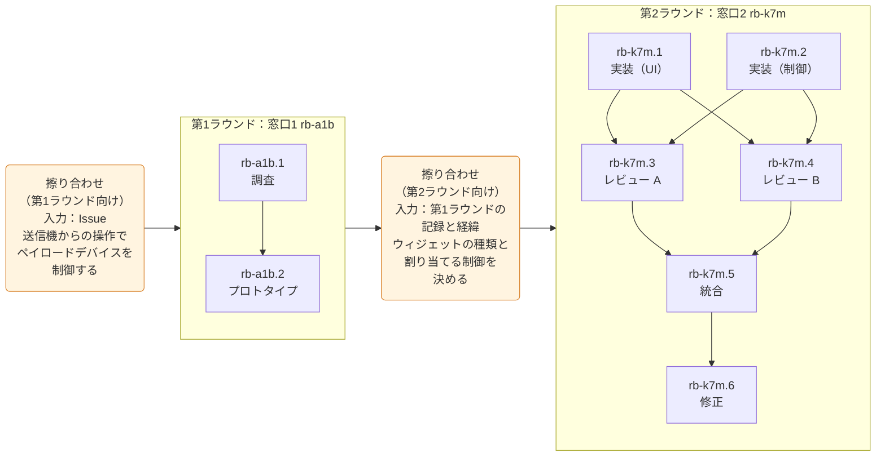
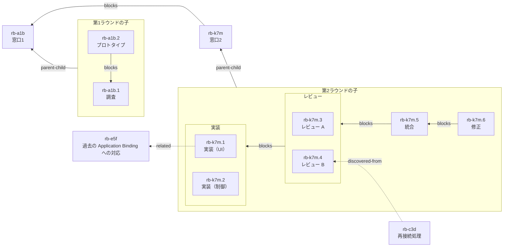
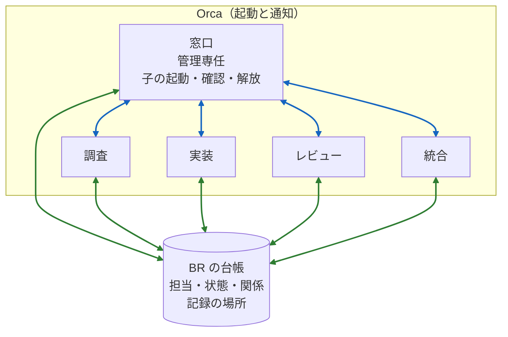
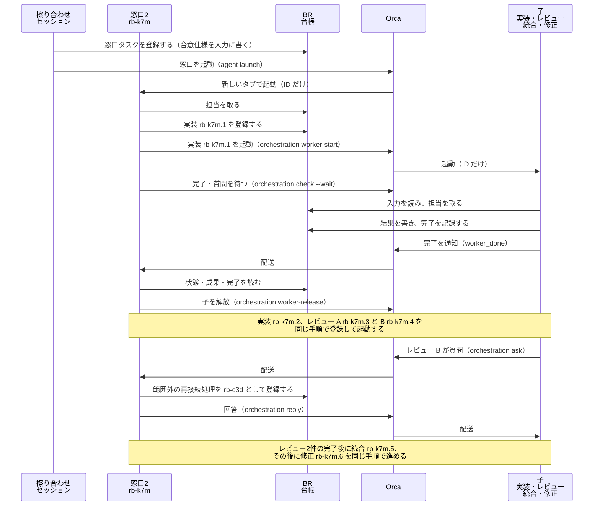
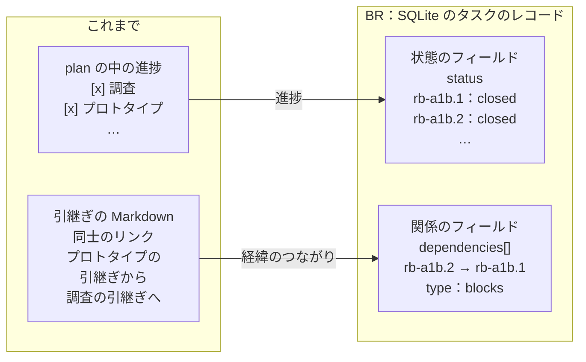

これは[豆蔵デベロッパーサイトアドベントカレンダー2026](/events/advent-calendar/2026/)第17日目の記事です。

## はじめに

コーディングエージェントに仕事を任せると、新しいセッションを開いた時に、これまでの経緯を伝え直すことがあります。調査で分かったこと、人と合意した仕様、レビューで出た指摘など、前のセッションが知っていたことを次のセッションは知りません。説明が漏れると作業の質が落ちます。これまでは、引継ぎ（handoff）を Markdown に残し、次のセッションに読ませて対応してきました。ただ、タスクが増えると、Markdown の引継ぎから経緯を追う負荷が高くなります。

この負荷に対して、2026年10月ごろから、BR（[Beads Rust](https://github.com/Dicklesworthstone/beads_rust)）というタスク台帳を試しています。あくまで現時点での選択で、運用は今後変わる可能性があります。本記事では、経緯を残す手段として BR を使ってみたので、次の2つを紹介します。

- BR を使ってみて分かったこと・気に入っていること
- BR と [Orca](https://orca.dev) を組み合わせて、エージェントが仕事をしやすくなったこと

本記事の例は、次の記事で紹介している案件の題材で組み立てた、説明用の架空の例です。

@[og](https://developer.mamezou-tech.com/robotics/solar-panel-clean-robot/dji-drone-psdk-introduction/)

@[og](https://developer.mamezou-tech.com/robotics/solar-panel-clean-robot/dji-drone-psdk-custom-widget/)

なお、エージェントに読ませる規約やスキルの整え方は、Web 上に情報が多いので本記事では扱いません。

## 人の開発では Issue 1件に担当1人だった

人が実装していた頃は、Issue 1件にだいたい担当が1人でした。担当者が調べ、実装し、PR を出します。独立したレビューは、PR の中でほかの人が行う程度でした。

Issue の手前の構造化も人の仕事でした。要求を構造化し、短い期間で終えられる大きさに分けます。ここまでは、エージェントに任せる今も人が行っています。

## エージェントに任せてから Issue 1件がタスク n 件になった

エージェントに任せ始めてから、進め方が変わりました。今は、1つの Issue が、完了条件を個別に確かめられる単位のタスクに分かれ、その多くを別のエージェントが担っています。例として、ドローンの送信機からの操作で、自作のペイロードデバイスを制御する Issue を考えます。ID とタスクの文言は説明用の架空の例で、説明しやすいように工程で分けています。



必要な情報が揃っていない時は、作業をいくつかの区切りに分けます。この区切りを「ラウンド」と呼びます。例では、調査とプロトタイプまでを第1ラウンドとし、第2ラウンドで実装・レビュー・統合・修正に進みます。各ラウンドの前には、人とエージェントで擦り合わせるセッションがあります。第1ラウンドの前は Issue から、第2ラウンドの前は第1ラウンドの記録と経緯から始めます。それぞれのラウンドには、タスクを管理する専任のエージェントを立てます。本記事では、このエージェントを窓口、窓口が起動する各担当を子と呼びます。

各タスクの内容は次のとおりです。

- 擦り合わせ（第1ラウンド向け）：Issue を入力に、人とエージェントが第1ラウンドの進め方を決める。窓口1を登録して起動する
- 第1ラウンド：窓口1 `rb-a1b` が子を管理する
  - 調査 `rb-a1b.1`：DJI の Payload SDK の API を調べる（送信機の操作をペイロードデバイスで受け取る方法）
  - プロトタイプ `rb-a1b.2`：Payload SDK でカスタムウィジェットを1つ作り、送信機に表示して操作を受け取る。調査の結果を前提にする
- 擦り合わせ（第2ラウンド向け）：第1ラウンドの記録と経緯を入力に、人とエージェントが、送信機に置くウィジェットの種類と、操作に割り当てる制御を決める。合意を仕様として残し、窓口2を登録して起動する
- 第2ラウンド：窓口2 `rb-k7m` が子を管理する
  - 実装（UI） `rb-k7m.1`：送信機に表示するウィジェットを作る。制御の部分はモックにして、UI だけで完了条件を確かめる
  - 実装（制御） `rb-k7m.2`：ウィジェットの操作に応じて、ペイロードデバイスを制御する
  - レビュー A `rb-k7m.3` とレビュー B `rb-k7m.4`：実装2件をまとめてレビューする。見落としを減らすため、2つのエージェントが独立に行う
  - 統合 `rb-k7m.5`：2つのレビュー結果を照合し、指摘の採否を決める。範囲外の指摘や、範囲内でもどこまで対応するかを、決めておいた基準で判断する
  - 修正 `rb-k7m.6`

Issue は1件のままですが、タスクは窓口を含めて10件になります。タスクが多くなってくると、だれが担当しているか、どこまで進んだか、どのタスクの完了を待っているかが分からなくなります。後から始まるセッションには、ほかのタスクで何が分かり、何が決まったのかという経緯も要ります。エージェントと人がこれらを確かめ、辿れるようにするには、記録をどこに置けばよいでしょうか。

## 記録をどこに置くか

記録の置き場所として、次の3つを比べました。

1つ目は GitHub の Issue です。Issue は、これまでどおり人が要求と合意を読み書きする場所にしておきたいと考えています。エージェントの進捗や経緯まで Issue に書くと、人が判断に使う情報がその中に埋もれます。また、Issue はリモートにあるので、エージェントが読み書きするたびに時間がかかります。複数のエージェントが同じ Issue に書くと、どのコメントがどのタスクの記録なのか分かりにくくなります。

2つ目は、引継ぎ用の Markdown ファイル同士をリンクでつなぐ方法です。ローカルなので速いのですが、経緯を追うにはファイルを1つずつ開いてリンクを辿るしかありません。だれが担当しているか、どこまで進んだかも、ファイルを開くまで分かりません。スキーマがないので、見出しや項目も担当ごとにばらつきます。

3つ目が BR です。担当・状態・関係を固定の項目で持ち、経緯を追うことを前提にしたスキーマと、それを読み書きする I/F を備えています。

| 観点 | GitHub Issue | Markdown のリンク | BR |
|---|---|---|---|
| 経緯の追いやすさ | △ Issue 同士の関連は張れるが、タスクごとに Issue を作ると数が増えすぎる | × 本文中のリンクを1件ずつ辿る | ○ 型付きの関係を ID から辿れる |
| 担当・状態の確かめやすさ | △ 担当と状態は Issue 単位で、タスク単位ではない | × 本文を読まないと分からない | ○ 固定の項目で、一覧や絞り込みができる |
| 速さ | × 毎回リモートを読み書きする | ○ ローカル | ○ ローカル |
| 複数エージェントの書き込み | × 同じ Issue に書くと記録が混ざる | △ ファイルを分ければ混ざらない | ○ タスクごとに担当を取って書く |

## BR の台帳の中身

BR は beads_rust の略で、CLI 名は `br` です。[beads](https://github.com/gastownhall/beads) を Rust へ移植した、エージェント向けのタスク台帳です。BR は単なる DB で、使う側を縛る制約がほとんどありません。以下は BR 0.7.6 の台帳で確かめた内容です。

### 保存の仕組み

台帳の本体は `.beads/beads.db`（SQLite）で、BR はここを読み書きします。`.beads/issues.jsonl` は、その内容を1行1タスクのテキストで書き出したものです。JSONL は、Git で共有したり、bv で閲覧したり、中身を確かめたりするのに使えます。台帳に書くのは BR だけで、エージェントは `br` コマンドを通して読み書きします。

### タスク1件の例

第2ラウンドのレビュー B `rb-k7m.4` を例に、台帳の1件を JSON で示します。`issues.jsonl` の1行を整形し、一部の項目を省略しています。値はすべて架空です。

```json
{
  "id": "rb-k7m.4",
  "title": "[PL] #12 送信機からの制御の実装のレビュー B",
  "issue_type": "task",
  "status": "closed",
  "priority": 2,
  "assignee": "review-b",
  "closed_at": "2026-11-20T06:42:10Z",
  "close_reason": "指摘3件をレビュー結果に記録した",
  "description": "**目的:** 送信機からの制御の実装 `rb-k7m.1`（UI）と `rb-k7m.2`（制御）を合意仕様と照合し、独立にレビューする。\n\n**完了条件:**\n- ...（後述）",
  "notes": "worker-start: {\"run_id\": \"run_8f2c\", \"task_id\": \"task_51d0\", \"dispatch_id\": \"ctx_a93e\", \"purpose\": \"review\", \"requested\": {\"model\": \"claude-opus-5-5\"}, \"effective\": {\"model\": \"claude-opus-5-5\"}, \"status\": \"started\"}",
  "labels": ["issue:PL:12", "repo:PL"],
  "dependencies": [
    { "issue_id": "rb-k7m.4", "depends_on_id": "rb-k7m", "type": "parent-child" },
    { "issue_id": "rb-k7m.4", "depends_on_id": "rb-k7m.1", "type": "blocks" },
    { "issue_id": "rb-k7m.4", "depends_on_id": "rb-k7m.2", "type": "blocks" }
  ],
  "comments": [
    {
      "author": "review-b",
      "text": "**結果:**\n\n- 指摘3件（重大1件、軽微2件）。\n...（後述）",
      "created_at": "2026-11-20T06:40:31Z"
    }
  ],
  "created_at": "2026-11-20T05:58:02Z",
  "created_by": "coord-2",
  "updated_at": "2026-11-20T06:42:10Z"
}
```

フィールドは、次のまとまりで読むと分かりやすくなります。

| まとまり | フィールド | 内容 |
|---|---|---|
| 識別 | `id`、`title`、`issue_type` | ID、題名、種別。子の ID は親の ID に連番を付けた形になる |
| 状態 | `status`、`priority`、`assignee`、`closed_at`、`close_reason` | 状態、優先度、担当、完了の日時と理由 |
| 本文 | `description`、`notes` | 説明（4項目の Markdown）と、起動の記録などの補足 |
| 分類 | `labels` | 対象のリポジトリや関連する Issue の番号 |
| 関係 | `dependencies[]`（`issue_id`・`depends_on_id`・`type`） | ほかのタスクとの型付きの関係 |
| 追記 | `comments[]`（`author`・`text`・`created_at`） | 担当が追記する進捗・結果・質問と回答 |
| 監査 | `created_at`、`created_by`、`updated_at` | 作成・更新の日時と作成者。例の作成者は、子タスクを登録した窓口2 |

### 説明の4項目

`description` は、目的・完了条件・入力・記録の4項目の Markdown で書いています。`rb-k7m.4` の説明は次のとおりです。入力と記録には、ワークスペースの中のパスを書きます。

```markdown
**目的:** 送信機からの制御の実装 `rb-k7m.1`（UI）と `rb-k7m.2`（制御）を合意仕様と照合し、独立にレビューする。

**完了条件:**
- 合意仕様のウィジェットの種類と、操作に割り当てる制御を、実装と照合している。
- 指摘ごとに根拠・該当箇所・重大度を記録している。
- ソースと設定を変更していない（読み取り専用）。

**入力:**

- 合意仕様: `issues/br/rb-k7m/spec.md`
- 実装（UI）の結果: `issues/br/rb-k7m.1/result.md`
- 実装（制御）の結果: `issues/br/rb-k7m.2/result.md`

**記録:**

- レビュー結果: `issues/br/rb-k7m.4/review.md`
```

完了条件は、独立して確かめられる事項に分けます。入力には役割名を付け、合意仕様やほかのタスクの結果を指します。記録には、成果のまとめ（例では `review.md`）を1件だけ書きます。ログなどの詳細な証拠は、そこから辿れるようにします。

### コメントの例

コメントは、結果・検証・残件の形で短く書きます。長い証拠や理由は、説明の「記録」に書いた Markdown へ置きます。

```markdown
**結果:**

- 指摘3件（重大1件、軽微2件）。
- 機体とのシリアル通信が切れた時の再接続処理がない。窓口の回答により、この Issue の範囲外として `rb-c3d` に分けた。

**検証:**

- 合意仕様のウィジェットの種類と、操作に割り当てた制御を、実装と照合した。

**残件:**

- 指摘の採否は、レビュー2件の完了後に窓口が登録する統合タスクで判断する。
- 詳細は `review.md` を参照。
```

### 関係の4種類

タスク間の関係は、次の4種類の `type` で持ちます。本記事では、括弧内の言葉で呼びます。

| `type` | 本記事での言葉 | 記録の向きと意味 |
|---|---|---|
| `parent-child` | 親子 | 子から親へ。窓口と子のように、成果を分割した構造を表す |
| `blocks` | 前提 | 後続から先行へ。先行が終わるまで後続は着手できない |
| `discovered-from` | 派生元 | 派生したタスクから、見つかった場所のタスクへ |
| `related` | 参考 | 参照する側から参照先へ。着手の条件にはしない |

窓口もタスクなので、窓口同士の関係も台帳に残ります。例では、窓口2 `rb-k7m` は窓口1 `rb-a1b` を前提にしています。実際に使っている台帳でも、窓口のタスク同士は前提・派生元・参考で結ばれています。

例ではほかに、実装（UI） `rb-k7m.1` が、過去のタスク `rb-e5f`（Application Binding への対応）を参考として結んでいます。例に出てくる関係を1枚に描くと、次のようになります。矢印は、関係を記録する側（`issue_id`）から相手（`depends_on_id`）へ向けています。枠から出る矢印と枠へ入る矢印は、枠の中のタスクそれぞれの関係を表します。



ID を1つ指定して取得すれば、状態・担当・関係・記録の場所が返ります。Markdown を開かなくても、経緯と今の状態が分かります。

台帳の中身は、閲覧用のツール [bv](https://github.com/Dicklesworthstone/beads_viewer) でも見られます。次の2枚は、本記事の例だけを入れた架空の台帳を bv で開いた画面です。1枚目は、左の一覧で `rb-c3d` を選んだ表示です。右側に、説明の4項目と、関係を辿った表示（Dependency Graph）が出ます。`rb-c3d` から辿ると、派生元・親子・前提・参考の4種類の関係が1画面に出ます。


2枚目は、同じ台帳のタスクを状態ごとに並べた表示です。


## plan から BR のタスクへ

BR を使う前は、人が認知できる大きさのタスクを決めて、エージェントに渡していました。エージェントは、作業の前に計画（plan）を立てて進めます。plan の中でどのような作業が行われたのかは、後から追いにくいものでした。

BR を試し始めてからは、そのタスクをさらに BR のタスクに分けています。分けたタスクにはそれぞれ担当と記録があり、作業の経緯がタスクごとに残ります。

例でいえば、以前は「送信機の操作でペイロードデバイスを制御する」というタスクを1つ渡し、調査から修正までが1つの plan の中にありました。今は、調査・プロトタイプ・実装・レビュー・統合・修正が、それぞれ BR のタスクになります。

ほかにも、作業の途中で、この Issue の範囲に入らない事項が見つかった時に違いが出ます。plan で進めていると、こうした残件をどこに残すかを、その都度人が考えていました。GitHub の Issue に登録すると決めておく手もありますが、内容を分析して擦り合わせてから載せたい場合もあります。今は、残件も台帳に登録すると決めているので、エージェントが自分で登録まで進められます。例では、レビュー B が再接続処理の抜けを見つけました。窓口は範囲外と判断し、別のタスク `rb-c3d` として登録しました。`rb-c3d` は担当のないまま台帳に残るので、人とエージェントの両方が残件として認識できます。作業の節目など都合の良い時に、別のセッションに `rb-c3d` を渡して擦り合わせ、Issue に登録するかどうかを決められます。派生元の `rb-k7m.4` から辿れるので、見つかった経緯も失われません。

## BR は状態、Orca はイベント

BR の台帳は静的です。だれが次に何をするかは書けますが、相手を起動したり、終わったことを知らせたりはできません。この役目を Orca に任せています。BR は状態を、Orca はイベントを受け持ちます。

全体像は次のとおりです。



Orca の枠の中の青い矢印は Orca の CLI、BR の台帳との間の緑の矢印は BR の CLI でのやり取りです。起動と通知の中身は、次の節で説明します。

Orca の紹介では、worktree を使ったエージェントの並列化が主題になることが多いと思います。この運用では、Orca を並列化より、エージェント同士の連携の基盤として使っています。

## 連携の例：実装からレビュー、統合まで

BR と Orca の連携を、例の第2ラウンドで1つの流れにして見せます。複数の独立したレビューと統合の流れ自体は、BR がなくても Orca だけで組める、一般的なオーケストレーションです。見てほしいのは、その流れの中で BR と Orca がそれぞれ受け持つことです。

擦り合わせのセッションが窓口2 `rb-k7m` を起動し、窓口が実装・レビュー・統合・修正の子を順に起動します。途中で、レビュー B が窓口へ質問する場面を入れています。矢印の括弧内は、使っている Orca 1.4.245 のサブコマンドです（`worker_done` だけは、完了を通知するメッセージの種類です）。詳細は、公式の [orchestration のドキュメント](https://orca.dev/docs/cli/orchestration) を参照してください。



例の質問は、再接続処理の扱いです。レビュー B が「機体とのシリアル通信が切れた時の再接続処理がないが、指摘に含めるか」と尋ね、窓口は合意仕様を確かめて「この Issue の範囲外」と答えます。質問と回答の経緯は、レビュー B のコメントに残ります。

### ID だけで起動し、通知で確かめる

図の「起動（ID だけ）」で子に渡るのは、BR の ID と、Orca の差し込む前置きだけです。前置きには、通知の送り方などが書かれています。タスク固有の内容は ID だけです。

```text
（Orca が差し込む前置き：完了の通知と質問の送り方など）

=== TASK ===
rb-k7m.4
```

子は入力を、BR と、BR の説明の「入力」が指すファイル（合意仕様やほかのタスクの結果）から集めます。起動の指示に経緯を書き写さないので、転記による欠落や要約の歪みが起きません。

子は作業を終えたら、BR に完了を記録してから Orca で完了を通知します。完了通知に成果の本文は載せません。窓口は通知を受けたら、BR で状態・成果・完了を確かめてから次へ進みます。

BR への記録と Orca の呼び出しは、自作の運用 CLI で1つの操作にまとめています。たとえば子の起動では、Orca で子を起動し、起動の記録を子の BR に残すまでを1回の呼び出しで行います。窓口が手順を取り違えても、記録が抜けないようにするためです。

### 子は成果を台帳から読む

窓口は次の子へ記録の場所を渡し、子は前の子の成果をそこから直接読みます。たとえば修正タスクの登録では、窓口は統合の状態とコメントの要約を確かめ、修正の「入力」に統合の記録のパスを書きます。修正担当は、統合の結果と元の指摘を、その入力から直接読みます。窓口が記録や差分を書き写して渡すことはありません。窓口は管理専任で実装の詳細を抱えないので、長い一連の作業でも劣化しにくくなります。

窓口が子の進捗をすべて覚えておけば、台帳は要らないと思うかもしれません。ただ、窓口も1つのセッションなので、コンテキストの上限やセッションの終了で、覚えたことを失います。ラウンドが変われば窓口も変わり、次の擦り合わせは前のラウンドの記録から始めます。窓口が監視して分かったことは、窓口の記憶ではなく台帳に残しています。

## エージェントが仕事しやすくなった

以前は、Markdown の引継ぎにまとめた経緯を、次のセッションが読んでいました。今は、BR の台帳が糸口になり、タスク同士の関係を辿れます。要約は BR のコメントで分かり、詳細が必要なタスクだけ「記録」の Markdown を読みます。経緯を追うために読む量が、必要な分だけで済みます。

起動と ID の受け渡しは、窓口や擦り合わせのセッションのエージェントが行うので、人の手間は減りました。ただ、それよりも、エージェントが仕事をしやすくなったことが重要だと考えています。入力が台帳と、台帳が指すファイルに揃っているので、どの担当も同じ手順で仕事を始められます。

タスクの分け方と、だれが担当するかを切り離せるのも、BR でタスク化しておく利点だと感じています。例の実装 `rb-k7m.1`・`rb-k7m.2` と修正 `rb-k7m.6` は別のタスクですが、実装したエージェントが続けて修正を担当することもあれば、新しいエージェントに任せることもあります。どちらにするかは、タスクの内容で決めています。修正を実装と同じエージェントに任せる時は、BR の担当から実装したエージェントが分かります。

## まとめ

BR を使う前（左）と後（右）で、進捗と経緯のつながりを残す場所は次のように変わりました。



plan の中の進捗と Markdown 同士のリンクが、台帳のタスクのフィールドになっています。

BR は、経緯を追うことを前提にしたスキーマと I/F を持ちながら、使う側を縛る制約がほとんどありません。そのため、組み合わせる相手は Orca に限らず、ほかのツールや自作の仕組みでもかまいません。今の運用では、BR は状態を、Orca はイベントを受け持ち、Orca のメッセージは BR を指す薄い合図で済んでいます。

これまでの関心は、エージェントが読む規約やスキルの整備に向いていました。BR を使ってみて、台帳の DB や自作の運用 CLI のように、エージェントが作業しやすい道具の大切さも改めて感じました。
