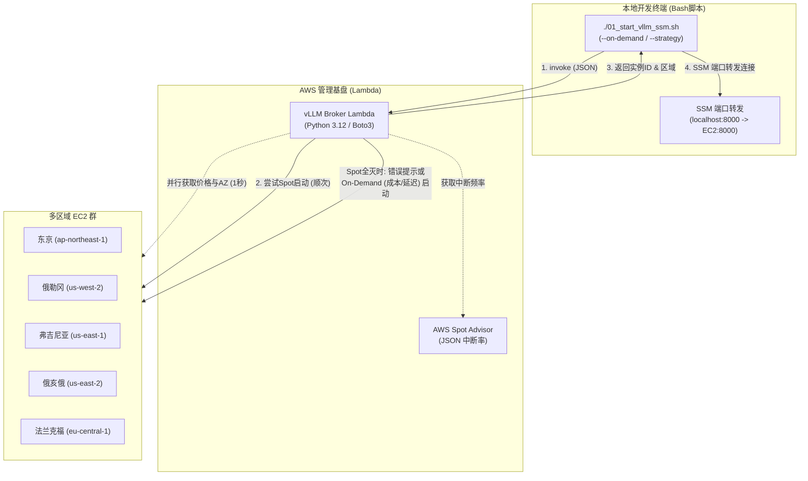

## 引言

这是一个将想到的创意和感兴趣的云技术，先凭着好奇心动手实践并成型的技术验证日志。

在上一篇文章（[通过EC2 Spot×vLLM结合SSM实现安全化！零端口开放直连](/blogs/2026/10/09/vllm_ssm_zero_inbound/)）中，我们引入了AWS Systems Manager（SSM）Session Manager的端口转发，实现了在安全组入站完全阻断（端口开放为0）的前提下，彻底废除SSH密钥管理的安全GPU使用环境。

但是，在第三回和第四回不断添加功能的过程中，**客户端（WSL/Mac等）的启动脚本（Bash）出现了新的运维挑战**：

1. **探索延迟较高（串行处理的限界）**：  
   Bash脚本通过AWS CLI逐次（串行）获取多个区域的Spot价格、AZ候选、Spot Advisor中断率，仅探索与打分就要等待15~30秒左右。  
2. **Spot枯竭（全灭）时的应对**：  
   受全球AI热潮影响，不同时段候选区域的Spot容量可能会全灭（`InsufficientInstanceCapacity`）。此时脚本会因错误停止，需要手动重新发起On-Demand实例，产生二次操作的麻烦。  
3. **本地环境臃肿与可维护性问题**：  
   Bash脚本内塞满了价格解析、中断率计算、JSON处理、AWK打分逻辑，Shell脚本的维护性已到极限。

因此，这次我们把“干脆在云端做一个能够并行高速自动探索并启动全球最廉价Spot GPU的Serverless API，是不是更有意思？”的想法落地，将这些判定与探索逻辑完全从客户端剥离，**进化为基于AWS Lambda的“无服务器GPU代理”**。

通过Python的`concurrent.futures`实现多区域、多AZ的高速并行扫描（1秒级完成），并引入**Spot枯竭时的智能“On-Demand回退功能”**，本篇将介绍这一实战方法。

:::info
**📚 相关的过往验证文章**
* **第1回（基本构成）**：[AWS×UserData自动启动vLLM！停机时成本几乎为零的本地LLM环境](/blogs/2026/09/16/vllm_autolaunch/)  
* **第2回（Cline联动）**：[自建vLLM通过Open WebUI接入VS Code（Cline）！无需Token开发](/blogs/2026/09/29/vllm_openwebui_cline/)  
* **第3回（Spot利用）**：[EC2 Spot实例×vLLM大幅削减GPU成本](/blogs/2026/10/02/vllm_spot_instance/)  
* **第4回（SSM安全化）**：[EC2 Spot×vLLM结合SSM实现安全化！零端口开放直连](/blogs/2026/10/09/vllm_ssm_zero_inbound/)  
:::

---

## 架构的演进要点

> **📌 本节要点**  
> 客户端摆脱探索与判定逻辑，仅需“调用Lambda并接收结果”。Lambda端负责所有区域的Boto3并行查询、综合打分、Spot启动尝试及On-Demand回退。



| 项目             | 第4回以前的架构（客户端Bash）             | 本次架构（Lambda Broker）              | 优势                                  |
| :--------------- | :---------------------------------------- | :------------------------------------- | :------------------------------------ |
| **探索速度**     | 15~30秒以上（CLI串行执行）                | **约1~2秒（Python线程并行）**         | 大幅缩短等待时间                      |
| **客户端职责**   | 获取价格、中断率、探索计算、尝试启动        | **仅调用Lambda并建立SSM隧道**        | 摆脱复杂探索逻辑                      |
| **Spot枯竭时**   | 错误中断，需要手动应对                    | **明确错误提示 & 切换On-Demand**      | 无需中断开发即可恢复                  |
| **常规启动策略** | 无                                       | **“成本最优”或“延迟最小”**           | 根据业务优先级灵活选择                |

---

## Spot枯竭时的回退设计

Spot实例利用多余容量，全球GPU需求高峰时段可能会在所有候选区域返回`InsufficientInstanceCapacity`，即“Spot枯竭”。

本系统采用以下两级回退策略：

1. **默认（Spot启动）**：  
   遍历所有候选区域尝试Spot启动，若全部库存耗尽，立即返回错误`ALL_SPOT_EXHAUSTED`。错误信息中清晰提示用户“添加`--on-demand`选项可重新执行”，避免自动切换On-Demand导致意外高额支出。  
2. **指定On-Demand（`--on-demand`）**：  
   若需立即继续作业，用户可显式指定`--on-demand`选项重跑，并可选择以下两种策略（`--strategy`）：  
   - **`cost`（成本最优·默认）**：比较所有区域的On-Demand原价（美元计），选定价格最低区域启动。  
   - **`latency`（低延迟优先）**：优先启动物理距离最近的东京区域（`ap-northeast-1`），确保流畅的打字和响应。

---

## Lambda函数实现 (`handler.py`)

Lambda函数的核心逻辑，无需外部库，仅依赖标准库（`concurrent.futures`, `urllib.request`）及`boto3`。

:::info
**💡 小技巧：将UserData外置至S3并使用3行Bootstrap**  
本实现将初始化脚本（NVMe挂载、Docker目录迁移、并行同步、vLLM启动、空闲自动停止）外置至S3（`s3://${S3_BUCKET}/scripts/startup.sh`），在UserData中仅保留“从S3拉取并执行”三行。  
- **大幅精简Lambda代码**：去除100行以上的Bash文档，提升可读性。  
- **快速迭代**：修改启动逻辑只需更新S3脚本，无需重建/重部署Lambda。  
- **绕过UserData 16KB限制**：脚本大小不再受EC2 UserData上限影响。
:::

<details><summary>handler.py（点击展开）</summary>

```python
"""
vLLM GPU Spot Broker Lambda
多区域Spot探索、最优区域选择、Spot启动及Terminate统一管理的无服务器代理
"""

import json
import logging
import urllib.request
import concurrent.futures
import boto3
from botocore.config import Config
import os

logger = logging.getLogger()
logger.setLevel(logging.INFO)

# 候选区域与实例类型
env_regions = os.environ.get("TARGET_REGIONS")
CANDIDATE_REGIONS = [r.strip() for r in env_regions.split(",") if r.strip()] if env_regions else ["ap-northeast-1", "eu-central-1", "us-east-2", "us-east-1", "us-west-2"]
INSTANCE_TYPE = os.environ.get("INSTANCE_TYPE", "g6.xlarge")
IAM_ROLE_NAME = os.environ.get("INSTANCE_PROFILE_NAME", "vllm-ssm-instance-profile")
TAG_SERVER_NAME = os.environ.get("TAG_SERVER_NAME", "vllm-ssm-spot-node")
S3_BUCKET_NAME = os.environ.get("S3_BUCKET_NAME", "vllm-models-storage")
ECR_REPOSITORY_NAME = os.environ.get("ECR_REPOSITORY_NAME", "vllm-openai")

# 各区域 AMI ID 缓存 (Ubuntu 22.04 Deep Learning AMI)
AMI_MAPPING = {
    "ap-northeast-1": "ami-0152728adca68ed36",
    "eu-central-1": "ami-0efde0090dab8cacf",
    "us-east-2": "ami-032b37e4db407994d",
    "us-east-1": "ami-012ba162b9cd2729c",
    "us-west-2": "ami-0ca70308d230e8a6e",
}

# 各区域On-Demand参考价格 ($/h: g6.xlarge)及从东京的估算RTT(ms)
ON_DEMAND_METRICS = {
    "ap-northeast-1": {"price": 1.3412, "latency_ms": 15, "name": "东京 (最低延迟·国内)"},
    "us-west-2":      {"price": 0.9840, "latency_ms": 110, "name": "俄勒冈 (成本最优·中延迟)"},
    "us-east-2":      {"price": 0.9840, "latency_ms": 150, "name": "俄亥俄 (成本最优)"},
    "us-east-1":      {"price": 0.9840, "latency_ms": 170, "name": "弗吉尼亚 (成本最优)"},
    "eu-central-1":   {"price": 1.2024, "latency_ms": 230, "name": "法兰克福"},
}

# S3外置Bootstrap UserData (主体从 s3://.../scripts/startup.sh 高速获取)
USERDATA_BOOTSTRAP = """#!/bin/bash
set -euo pipefail
LOG_FILE="/var/log/userdata-bootstrap.log"
exec > >(tee -a "${LOG_FILE}" | logger -t user-data -s 2>/dev/console) 2>&1

AWS_REGION="__AWS_REGION__"
S3_BUCKET="__S3_BUCKET_NAME__"
DOCKER_IMAGE="__DOCKER_IMAGE__"

echo "=== 从 S3 获取启动脚本 (startup.sh) ==="
aws s3 cp "s3://${S3_BUCKET}/scripts/startup.sh" /tmp/startup.sh --region "${AWS_REGION}"
chmod +x /tmp/startup.sh

echo "=== 执行 startup.sh ==="
/tmp/startup.sh "${AWS_REGION}" "${S3_BUCKET}" "${DOCKER_IMAGE}"
"""

def get_spot_advisor_data():
    """从Spot Advisor获取中断频率等级"""
    url = "https://spot-bid-advisor.s3.amazonaws.com/spot-advisor-data.json"
    tiers = {}
    try:
        req = urllib.request.Request(url, headers={"User-Agent": "Lambda-Broker"})
        with urllib.request.urlopen(req, timeout=3) as res:
            adv = json.loads(res.read().decode("utf-8")).get("spot_advisor", {})
            for r, info in adv.items():
                tier = info.get("Linux", {}).get(INSTANCE_TYPE, {}).get("r", 4)
                tiers[r] = tier
    except Exception as e:
        logger.warning(f"Spot Advisor 获取失败: {e}")
    return tiers

def query_region_metrics(region, advisor_tiers):
    """获取单一区域的Spot价格和AZ数量"""
    boto_cfg = Config(connect_timeout=2, read_timeout=3, retries={"max_attempts": 1})
    ec2 = boto3.client("ec2", region_name=region, config=boto_cfg)
    try:
        res = ec2.describe_spot_price_history(
            InstanceTypes=[INSTANCE_TYPE],
            ProductDescriptions=["Linux/UNIX"],
            MaxResults=10,
        )
        prices = res.get("SpotPriceHistory", [])
        if not prices:
            return None

        # 最低价格与AZ数量
        min_price = min(float(p["SpotPrice"]) for p in prices)
        azs = set(p["AvailabilityZone"] for p in prices)
        az_count = len(azs)
        tier = advisor_tiers.get(region, 4)

        return {
            "region": region,
            "min_price": min_price,
            "az_count": az_count,
            "tier": tier,
        }
    except Exception as e:
        logger.error(f"Error querying {region}: {e}")
        return None

def select_best_region():
    """并行评估所有候选区域并计算最优区域"""
    advisor_tiers = get_spot_advisor_data()
    metrics = []

    with concurrent.futures.ThreadPoolExecutor(max_workers=len(CANDIDATE_REGIONS)) as executor:
        futures = {executor.submit(query_region_metrics, r, advisor_tiers): r for r in CANDIDATE_REGIONS}
        for future in concurrent.futures.as_completed(futures):
            res = future.result()
            if res:
                metrics.append(res)

    if not metrics:
        raise RuntimeError("无法在所有区域获取到Spot价格")

    best_price = min(m["min_price"] for m in metrics)

    # 分数计算: 价格占40 + 多余AZ占40 + 中断耐性占20
    best_item = None
    max_score = -1

    for m in metrics:
        p_score = int(40.0 * (best_price / m["min_price"]))

        tier = m["tier"]
        i_score = {0: 20, 1: 15, 2: 10, 3: 5}.get(tier, 0)

        az = m["az_count"]
        if az >= 5:
            c_score = 40
        elif az == 4:
            c_score = 32
        elif az == 3:
            c_score = 24
        elif az == 2:
            c_score = 16
        else:
            c_score = 8

        total_score = p_score + i_score + c_score
        m["score"] = total_score
        if total_score >= 75:
            m["rank"] = "Rank S"
        elif total_score >= 65:
            m["rank"] = "Rank A"
        elif total_score >= 50:
            m["rank"] = "Rank B"
        else:
            m["rank"] = "Rank C"

        if total_score > max_score:
            max_score = total_score
            best_item = m

    return best_item, metrics

def get_or_create_ssm_security_group(ec2_client, region):
    """用于SSM的完全阻断入站流量（0接收规则）安全组"""
    sg_name = "vllm-ssm-isolated-sg"
    try:
        res = ec2_client.describe_security_groups(
            Filters=[{"Name": "group-name", "Values": [sg_name]}]
        )
        if res["SecurityGroups"]:
            return res["SecurityGroups"][0]["GroupId"]
    except Exception:
        pass

    # 创建（默认VPC）
    vpcs = ec2_client.describe_vpcs(Filters=[{"Name": "isDefault", "Values": ["true"]}])["Vpcs"]
    vpc_id = vpcs[0]["VpcId"] if vpcs else ec2_client.describe_vpcs()["Vpcs"][0]["VpcId"]

    new_sg = ec2_client.create_security_group(
        GroupName=sg_name,
        Description="Zero inbound ports allowed - access exclusively via AWS Systems Manager (SSM)",
        VpcId=vpc_id,
    )
    # 不添加任何入站规则（完全阻断）
    return new_sg["GroupId"]

def get_latest_dlami(ec2_client):
    """动态获取最新Ubuntu 22.04 Deep Learning AMI ID"""
    try:
        res = ec2_client.describe_images(
            Owners=["amazon"],
            Filters=[{"Name": "name", "Values": ["Deep Learning OSS Nvidia Driver AMI GPU PyTorch 2.* (Ubuntu 22.04)*"]}],
        )
        images = sorted(res.get("Images", []), key=lambda x: x["CreationDate"])
        if images:
            return images[-1]["ImageId"]
    except Exception as e:
        logger.warning(f"Failed to query latest DLAMI: {e}")
    return None

def select_on_demand_region(strategy="cost"):
    """选择常规启动（On-Demand）时的最优区域
    - cost：选择On-Demand单价最低的区域（同价时优先延迟低：us-west-2 > us-east-2 > us-east-1）
    - latency：选择从东京延迟最低的区域（ap-northeast-1优先）
    """
    valid_regions = [r for r in CANDIDATE_REGIONS if r in ON_DEMAND_METRICS]
    if not valid_regions:
        valid_regions = CANDIDATE_REGIONS

    if strategy == "latency":
        return sorted(valid_regions, key=lambda r: ON_DEMAND_METRICS.get(r, {}).get("latency_ms", 999))
    else:
        return sorted(
            valid_regions,
            key=lambda r: (
                ON_DEMAND_METRICS.get(r, {}).get("price", 999),
                ON_DEMAND_METRICS.get(r, {}).get("latency_ms", 999),
            ),
        )

def launch_instance(region, account_id, is_spot=True):
    """在指定区域启动实例（Spot或On-Demand）"""
    ec2 = boto3.client("ec2", region_name=region, config=Config(retries={"max_attempts": 1}))

    ami_id = AMI_MAPPING.get(region)
    if not ami_id:
        ami_id = get_latest_dlami(ec2)
        if not ami_id:
            raise ValueError(f"AMI ID not configured for region {region}")

    sg_id = get_or_create_ssm_security_group(ec2, region)

    s3_bucket = S3_BUCKET_NAME
    if not s3_bucket or s3_bucket == "vllm-models-storage" or "*" in s3_bucket:
        s3_bucket = f"my-vllm-models-hackathon-2026-{account_id}-{region}-an"
    elif "{account_id}" in s3_bucket or "{region}" in s3_bucket:
        s3_bucket = s3_bucket.replace("{account_id}", account_id).replace("{region}", region)

    docker_image = f"{account_id}.dkr.ecr.{region}.amazonaws.com/{ECR_REPOSITORY_NAME}:latest"

    # 生成UserData (S3外置Bootstrap)
    userdata_script = USERDATA_BOOTSTRAP.replace("__AWS_REGION__", region)
    userdata_script = userdata_script.replace("__S3_BUCKET_NAME__", s3_bucket)
    userdata_script = userdata_script.replace("__DOCKER_IMAGE__", docker_image)

    def do_run(target_ami):
        run_params = {
            "ImageId": target_ami,
            "InstanceType": INSTANCE_TYPE,
            "MinCount": 1,
            "MaxCount": 1,
            "IamInstanceProfile": {"Name": IAM_ROLE_NAME},
            "SecurityGroupIds": [sg_id],
            "InstanceInitiatedShutdownBehavior": "terminate",
            "BlockDeviceMappings": [
                {
                    "DeviceName": "/dev/sda1",
                    "Ebs": {
                        "VolumeSize": 40,
                        "VolumeType": "gp3",
                        "DeleteOnTermination": True,
                    },
                }
            ],
            "UserData": userdata_script,
            "TagSpecifications": [
                {
                    "ResourceType": "instance",
                    "Tags": [
                        {"Key": "Name", "Value": TAG_SERVER_NAME},
                        {"Key": "Project", "Value": "vllm-ephemeral"},
                        {"Key": "MarketType", "Value": "spot" if is_spot else "on-demand"},
                    ],
                }
            ],
        }

        if is_spot:
            run_params["InstanceMarketOptions"] = {
                "MarketType": "spot",
                "SpotOptions": {
                    "SpotInstanceType": "one-time",
                    "InstanceInterruptionBehavior": "terminate",
                },
            }

        return ec2.run_instances(**run_params)

    try:
        run_res = do_run(ami_id)
    except Exception as e:
        if "InvalidAMIID" in str(e):
            logger.info(f"AMI {ami_id} invalid in {region}, querying latest dynamically...")
            dynamic_ami = get_latest_dlami(ec2)
            if dynamic_ami and dynamic_ami != ami_id:
                run_res = do_run(dynamic_ami)
            else:
                raise
        else:
            raise

    instance_id = run_res["Instances"][0]["InstanceId"]
    return instance_id

def launch_spot_instance(best_region_info, account_id):
    """向后兼容别名"""
    return launch_instance(best_region_info["region"], account_id, is_spot=True)

def terminate_all_instances():
    """从所有候选区域查找正在运行的vLLM实例（包括Spot和On-Demand）并终止"""
    terminated = []

    def check_and_term(region):
        ec2 = boto3.client("ec2", region_name=region)
        try:
            res = ec2.describe_instances(
                Filters=[
                    {"Name": "tag:Name", "Values": [TAG_SERVER_NAME]},
                    {"Name": "instance-state-name", "Values": ["pending", "running", "stopping"]},
                ]
            )
            ids = [i["InstanceId"] for r in res.get("Reservations", []) for i in r.get("Instances", [])]
            if ids:
                ec2.terminate_instances(InstanceIds=ids)
                return [{"region": region, "instance_id": i} for i in ids]
        except Exception as e:
            logger.error(f"Error terminating in {region}: {e}")
        return []

    with concurrent.futures.ThreadPoolExecutor(max_workers=len(CANDIDATE_REGIONS)) as executor:
        results = executor.map(check_and_term, CANDIDATE_REGIONS)
        for r_list in results:
            terminated.extend(r_list)

    return terminated

def terminate_all_spot_instances():
    """向后兼容别名"""
    return terminate_all_instances()

def lambda_handler(event, context):
    """Lambda 主入口点"""
    action = event.get("action", "launch")
    mode = event.get("mode", "spot")  # "spot" or "on-demand"
    if event.get("on_demand") is True or event.get("use_on_demand") is True:
        mode = "on-demand"
    strategy = event.get("strategy", "cost").lower()  # "cost" or "latency"

    account_id = context.invoked_function_arn.split(":")[4]

    logger.info(f"Received action: {action}, mode: {mode}, strategy: {strategy} (Account: {account_id})")

    if action == "launch":
        if mode == "on-demand":
            # 常规启动（On-Demand）
            candidates = select_on_demand_region(strategy)
            logger.info(f"On-Demand候选区域顺序 (strategy={strategy}): {candidates}")

            failed_attempts = []
            last_error = None

            for region in candidates:
                info = ON_DEMAND_METRICS.get(region, {"price": 1.0, "latency_ms": 100, "name": region})
                logger.info(f"Attempting On-Demand launch in {region} ({info.get('name')})...")
                try:
                    instance_id = launch_instance(region, account_id, is_spot=False)
                    logger.info(f"Successfully launched On-Demand instance {instance_id} in {region}")
                    return {
                        "status": "success",
                        "action": "launch",
                        "market_type": "on-demand",
                        "strategy": strategy,
                        "region": region,
                        "region_name": info.get("name"),
                        "instance_id": instance_id,
                        "instance_type": INSTANCE_TYPE,
                        "on_demand_price": info.get("price"),
                        "latency_ms": info.get("latency_ms"),
                        "fallback_attempts": failed_attempts,
                        "note": f"常规启动（On-Demand）完成（优先策略: {strategy}）。",
                    }
                except Exception as e:
                    err_str = str(e)
                    if "VcpuLimitExceeded" in err_str or "InstanceLimitExceeded" in err_str:
                        reason = "On-Demand GPU配额上限"
                    else:
                        reason = f"{type(e).__name__}"
                    logger.warning(f"On-Demand launch failed in {region} ({reason})")
                    failed_attempts.append({"region": region, "reason": reason})
                    last_error = e
                    continue

            return {
                "status": "error",
                "error_code": "ALL_ON_DEMAND_FAILED",
                "message": f"在所有On-Demand候选区域启动均失败。Last error: {last_error}",
                "fallback_attempts": failed_attempts,
            }

        else:
            # 默认: Spot启动
            _, all_metrics = select_best_region()
            sorted_candidates = sorted(all_metrics, key=lambda x: x.get("score", 0), reverse=True)
            logger.info(f"Ranked spot candidates: {[c['region'] for c in sorted_candidates]}")

            failed_attempts = []
            last_error = None
            for candidate in sorted_candidates:
                region = candidate["region"]
                logger.info(f"Attempting spot launch in {region} (Score: {candidate.get('score')}, Rank: {candidate.get('rank')})...")
                try:
                    instance_id = launch_instance(region, account_id, is_spot=True)
                    logger.info(f"Successfully launched spot instance {instance_id} in {region}")
                    return {
                        "status": "success",
                        "action": "launch",
                        "market_type": "spot",
                        "region": region,
                        "instance_id": instance_id,
                        "instance_type": INSTANCE_TYPE,
                        "spot_price": candidate.get("min_price"),
                        "score": candidate.get("score"),
                        "rank": candidate.get("rank"),
                        "candidates": all_metrics,
                        "fallback_attempts": failed_attempts,
                    }
                except Exception as e:
                    err_str = str(e)
                    if "InsufficientInstanceCapacity" in err_str:
                        reason = "Spot容量不足 (耗尽)"
                    elif "MaxSpotInstanceCountExceeded" in err_str:
                        reason = "Spot配额上限"
                    else:
                        reason = f"{type(e).__name__}"
                    logger.warning(f"Spot launch failed in {region} ({reason}), trying next candidate...")
                    failed_attempts.append({
                        "region": region,
                        "score": candidate.get("score"),
                        "rank": candidate.get("rank"),
                        "reason": reason,
                    })
                    last_error = e
                    continue

            # ★ 全区域Spot获取失败时的错误响应
            return {
                "status": "error",
                "error_code": "ALL_SPOT_EXHAUSTED",
                "message": (
                    "所有候选区域Spot实例启动失败（可能因容量不足等）。\n"
                    "如果要使用常规启动（On-Demand），请在脚本中指定 '--on-demand' 选项。\n"
                    "  例: ./01_start_vllm_ssm.sh --on-demand --strategy cost     # 成本最优（美俄勒冈等: 约$0.98/h）\n"
                    "  例: ./01_start_vllm_ssm.sh --on-demand --strategy latency  # 延迟最小（东京: 约$1.34/h）"
                ),
                "fallback_attempts": failed_attempts,
            }

    elif action == "terminate":
        terminated = terminate_all_instances()
        return {
            "status": "success",
            "action": "terminate",
            "terminated_instances": terminated,
            "count": len(terminated),
        }

    elif action == "status":
        best_region_info, all_metrics = select_best_region()
        return {
            "status": "success",
            "action": "status",
            "recommended_region": best_region_info,
            "all_metrics": all_metrics,
        }

    else:
        return {
            "status": "error",
            "message": f"Unknown action: '{action}'. Must be 'launch', 'terminate', or 'status'.",
        }
```

</details>

---

## 在 S3 上部署的初始化脚本 (`startup.sh`)

将以下初始化脚本上传至S3（`s3://${S3_BUCKET}/scripts/startup.sh`）。实例启动时通过UserData自动从S3下载并执行。本脚本封装了NVMe挂载、Docker数据目录迁移、S3模型并行同步、vLLM启动及空闲自动停止守护进程等全流程。

<details><summary>startup.sh（点击展开）</summary>

```bash
#!/bin/bash
set -euo pipefail

LOG_FILE="/var/log/userdata-vllm.log"
exec > >(tee -a "${LOG_FILE}" | logger -t user-data -s 2>/dev/console) 2>&1

echo "=== [$(date '+%Y-%m-%d %H:%M:%S')] startup.sh 执行开始（S3外置Bootstrap版） ==="

AWS_REGION="${1:-$(curl -s http://169.254.169.254/latest/meta-data/placement/region)}"
S3_BUCKET_NAME="${2:-}"
DOCKER_IMAGE="${3:-}"

HF_MODEL_ID="Qwen/Qwen2.5-Coder-7B-Instruct"
SERVED_MODEL_NAME="Qwen/Qwen2.5-Coder-7B-Instruct"
VLLM_PORT="8000"
GPU_MEMORY_UTILIZATION="0.90"
MAX_MODEL_LEN="16384"

# 1. 检测并利用本地 NVMe 实例存储（250GB）
NVME_DIR="/opt/dlami/nvme"
if mountpoint -q "${NVME_DIR}" || [ -d "${NVME_DIR}" ]; then
    echo "正在使用 DLAMI 默认的 NVMe 挂载点 (${NVME_DIR})..."
    mkdir -p "${NVME_DIR}/models" "${NVME_DIR}/docker"
    mkdir -p /data
    ln -sfn "${NVME_DIR}/models" /data/models
else
    NVME_DEV=$(lsblk -d -n -o NAME,SIZE | grep -E '250G|232G' | head -n1 | awk '{print $1}')
    if [ -n "${NVME_DEV}" ]; then
        mkfs.ext4 -F "/dev/${NVME_DEV}" || true
        mkdir -p /data
        mount -o noatime "/dev/${NVME_DEV}" /data || true
    else
        mkdir -p /data
    fi
    mkdir -p /data/models /data/docker
    NVME_DIR="/data"
fi

LOCAL_MODEL_ROOT="/data/models"
LOCAL_MODEL_DIR="${LOCAL_MODEL_ROOT}/${HF_MODEL_ID}"
mkdir -p "${LOCAL_MODEL_DIR}"
chmod 777 "${LOCAL_MODEL_ROOT}"

# 2. 将 Docker 数据目录置于 NVMe 上
systemctl stop docker containerd || true
mkdir -p "${NVME_DIR}/docker" "${NVME_DIR}/containerd"
mkdir -p /var/lib/docker /var/lib/containerd
cp -a /var/lib/docker/* "${NVME_DIR}/docker/" 2>/dev/null || true
cp -a /var/lib/containerd/* "${NVME_DIR}/containerd/" 2>/dev/null || true
mount --bind "${NVME_DIR}/docker" /var/lib/docker
mount --bind "${NVME_DIR}/containerd" /var/lib/containerd
systemctl daemon-reload
systemctl start containerd
systemctl start docker

# 3. 并行执行 S3 模型同步 与 Docker pull
S3_SRC="s3://${S3_BUCKET_NAME}/models/${HF_MODEL_ID}"
aws configure set default.s3.max_concurrent_requests 20

(
    echo "--- [任务 A] 获取 Docker 镜像: ${DOCKER_IMAGE} ---"
    if [[ "${DOCKER_IMAGE}" == *".dkr.ecr."* ]]; then
        ECR_REGISTRY=$(echo "${DOCKER_IMAGE}" | cut -d'/' -f1)
        ECR_REGION=$(echo "${ECR_REGISTRY}" | awk -F. '{print $4}')
        aws ecr get-login-password --region "${ECR_REGION:-${AWS_REGION}}" | docker login --username AWS --password-stdin "${ECR_REGISTRY}" || true
    fi
    docker pull "${DOCKER_IMAGE}"
) > /var/log/docker-pull.log 2>&1 &
PID_DOCKER=$!

(
    echo "--- [任务 B] S3 模型高速同步 ---"
    aws s3 sync "${S3_SRC}" "${LOCAL_MODEL_DIR}" --region "${AWS_REGION}" --no-progress
) > /var/log/model-sync.log 2>&1 &
PID_S3=$!

wait "${PID_DOCKER}"
wait "${PID_S3}"
echo "=== 并行下载完成！ ==="

# 4. 启动vLLM容器
docker run -d \
    --name "vllm-server" \
    --restart unless-stopped \
    --gpus all \
    --ipc=host \
    -p "${VLLM_PORT}:8000" \
    -v "${LOCAL_MODEL_ROOT}:/models" \
    "${DOCKER_IMAGE}" \
    --model "/models/${HF_MODEL_ID}" \
    --served-model-name "${SERVED_MODEL_NAME}" \
    --gpu-memory-utilization "${GPU_MEMORY_UTILIZATION}" \
    --max-model-len "${MAX_MODEL_LEN}" \
    --trust-remote-code \
    --enable-auto-tool-choice \
    --tool-call-parser hermes

# 5. 空闲1小时自动关机守护进程
cat <<'EOF_IDLE' > /usr/local/bin/auto-idle-shutdown.sh
#!/bin/bash
IDLE_LIMIT=3600
IDLE_COUNT=0
while true; do
    sleep 300
    REQ=$(docker logs --since 5m vllm-server 2>&1 | grep -c "POST /v1" || true)
    if [ "${REQ}" -eq 0 ]; then
        IDLE_COUNT=$((IDLE_COUNT + 300))
        [ "${IDLE_COUNT}" -ge "${IDLE_LIMIT}" ] && { shutdown -h now; exit 0; }
    else
        IDLE_COUNT=0
    fi
done
EOF_IDLE
chmod +x /usr/local/bin/auto-idle-shutdown.sh
nohup /usr/local/bin/auto-idle-shutdown.sh > /dev/null 2>&1 &
echo "=== startup.sh 完成 (等待SSM) ==="
```

</details>

---

## Lambda部署脚本 (`00_deploy_lambda.sh`)

下述脚本将 `handler.py` 打包为ZIP并部署至AWS Lambda，同时将 `startup.sh` 同步至S3桶。

<details><summary>00_deploy_lambda.sh（点击展开）</summary>

```bash
#!/bin/bash
set -euo pipefail

# ==============================================================================
# 00_deploy_lambda.sh
# GPU启动Broker Lambda函数及IAM执行角色自动创建与更新脚本
# ==============================================================================

SCRIPT_DIR="$(cd "$(dirname "${BASH_SOURCE[0]}")" && pwd)"
LAMBDA_DIR="$(cd "${SCRIPT_DIR}/../lambda" && pwd)"
FUNCTION_NAME="vllm-spot-broker"
ROLE_NAME="vllm-spot-broker-lambda-role"
REGION="ap-northeast-1"

echo "=== 1. Lambda 执行角色 (${ROLE_NAME}) 的创建/确认 ==="
AWS_ACCOUNT_ID=$(aws sts get-caller-identity --query Account --output text)

TRUST_POLICY='{
  "Version": "2012-10-17",
  "Statement": [
    {
      "Effect": "Allow",
      "Principal": {
        "Service": "lambda.amazonaws.com"
      },
      "Action": "sts:AssumeRole"
    }
  ]
}'

if ! aws iam get-role --role-name "${ROLE_NAME}" >/dev/null 2>&1; then
    echo "正在创建 IAM 角色..."
    aws iam create-role \
        --role-name "${ROLE_NAME}" \
        --assume-role-policy-document "${TRUST_POLICY}" \
        --description "Execution role for vLLM Spot Broker Lambda" >/dev/null
    
    # 基本日志输出权限
    aws iam attach-role-policy \
        --role-name "${ROLE_NAME}" \
        --policy-arn "arn:aws:iam::aws:policy/service-role/AWSLambdaBasicExecutionRole"
    
    # EC2 & IAM PassRole 权限内联策略
    BROKER_POLICY="{
      \"Version\": \"2012-10-17\",
      \"Statement\": [
        {
          \"Effect\": \"Allow\",
          \"Action\": [
            \"ec2:Describe*\",
            \"ec2:RunInstances\",
            \"ec2:TerminateInstances\",
            \"ec2:CreateSecurityGroup\",
            \"ec2:CreateTags\"
          ],
          \"Resource\": \"*\"
        },
        {
          \"Effect\": \"Allow\",
          \"Action\": \"iam:PassRole\",
          \"Resource\": [
            \"arn:aws:iam::${AWS_ACCOUNT_ID}:role/vllm-ssm-instance-role\",
            \"arn:aws:iam::${AWS_ACCOUNT_ID}:role/VllmServerSSMRole\"
          ]
        }
      ]
    }"
    
    aws iam put-role-policy \
        --role-name "${ROLE_NAME}" \
        --policy-name "VllmBrokerPermissions" \
        --policy-document "${BROKER_POLICY}"
    
    echo "IAM 角色创建完成。等待权限传播中..."
    sleep 10
else
    echo "将使用已存在的 IAM 角色: ${ROLE_NAME}"
fi

ROLE_ARN="arn:aws:iam::${AWS_ACCOUNT_ID}:role/${ROLE_NAME}"

echo "=== 2. Lambda 代码打包 ==="
TMP_ZIP=$(mktemp --suffix=.zip)
rm -f "${TMP_ZIP}"
(cd "${LAMBDA_DIR}" && zip -q -r "${TMP_ZIP}" handler.py)

echo "=== 2.5 将启动脚本 (startup.sh) 同步到 S3 ==="
S3_BUCKET="my-vllm-models-hackathon-2026-${AWS_ACCOUNT_ID}-${REGION}-an"
if aws s3 ls "s3://${S3_BUCKET}" >/dev/null 2>&1; then
    echo "正在将 startup.sh 上传到 s3://${S3_BUCKET}/scripts/startup.sh ..."
    aws s3 cp "${SCRIPT_DIR}/startup.sh" "s3://${S3_BUCKET}/scripts/startup.sh" --region "${REGION}"
fi

echo "=== 3. 创建/更新 Lambda 函数 (${FUNCTION_NAME}) ==="
if aws lambda get-function --region "${REGION}" --function-name "${FUNCTION_NAME}" >/dev/null 2>&1; then
    echo "正在更新已存在的 Lambda 函数代码..."
    aws lambda update-function-code \
        --region "${REGION}" \
        --function-name "${FUNCTION_NAME}" \
        --zip-file "fileb://${TMP_ZIP}" >/dev/null
else
    echo "正在创建新的 Lambda 函数..."
    aws lambda create-function \
        --region "${REGION}" \
        --function-name "${FUNCTION_NAME}" \
        --runtime "python3.12" \
        --role "${ROLE_ARN}" \
        --handler "handler.lambda_handler" \
        --zip-file "fileb://${TMP_ZIP}" \
        --timeout 60 \
        --memory-size 256 \
        --description "Multi-region spot instance broker for vLLM" >/dev/null
fi

rm -f "${TMP_ZIP}"
echo "=== 部署完成！ ==="
echo "Lambda 函数名: ${FUNCTION_NAME} (${REGION})"
```

</details>

---

## 摆脱探索逻辑的客户端脚本 (`01_start_vllm_ssm.sh`)

本地脚本将复杂的多区域运算和中断率获取完全放到云端，仅负责“调用Lambda获取实例信息并建立SSM端口转发”这一连接与隧道管理任务。

<details><summary>01_start_vllm_ssm.sh（点击展开）</summary>

```bash
#!/bin/bash
set -euo pipefail

# ==============================================================================
# 01_start_vllm_ssm.sh
# 调用Lambda Broker启动最便宜的Spot，并通过SSM端口转发安全直连
# ==============================================================================

SCRIPT_DIR="$(cd "$(dirname "${BASH_SOURCE[0]}")" && pwd)"
INSTANCE_STATE_FILE="${SCRIPT_DIR}/.current_instance_id"
TUNNEL_PID_FILE="${SCRIPT_DIR}/.current_tunnel_pid"
REGION_STATE_FILE="${SCRIPT_DIR}/.current_region"
TUNNEL_LOG="${SCRIPT_DIR}/.current_tunnel.log"

BROKER_REGION="ap-northeast-1"
FUNCTION_NAME="vllm-spot-broker"

# 选项解析
USE_ON_DEMAND="false"
STRATEGY="cost"

while [[ $# -gt 0 ]]; do
    case "$1" in
        --on-demand)
            USE_ON_DEMAND="true"
            shift
            ;;
        --strategy)
            STRATEGY="${2:-cost}"
            shift 2
            ;;
        -h|--help)
            echo "用法: $0 [选项]"
            echo ""
            echo "选项："
            echo "  --on-demand               使用常规启动（on-demand）（默认Spot启动）"
            echo "  --strategy <cost|latency> 常规启动时的优先策略（默认: cost）"
            echo "      cost    : 选择on-demand单价最低的区域（如美俄勒冈：约\$0.98/h）"
            echo "      latency : 选择延迟最小的区域（东京：约\$1.34/h）"
            echo "  -h, --help                显示帮助"
            exit 0
            ;;
        *)
            echo "未知选项: $1"
            echo "帮助: $0 --help"
            exit 1
            ;;
    esac
done

TMP_RES=$(mktemp)

if [ "${USE_ON_DEMAND}" = "true" ]; then
    echo "=== 1. 调用无服务器GPU代理（Lambda） [常规启动 / 策略: ${STRATEGY}]... ==="
    PAYLOAD=$(jq -n --arg mode "on-demand" --arg strategy "${STRATEGY}" '{"action":"launch","mode":$mode,"strategy":$strategy}')
else
    echo "=== 1. 调用无服务器GPU代理（Lambda） [Spot探索 & 启动]... ==="
    PAYLOAD='{"action":"launch","mode":"spot"}'
fi

aws lambda invoke \
    --region "${BROKER_REGION}" \
    --function-name "${FUNCTION_NAME}" \
    --payload "${PAYLOAD}" \
    --cli-binary-format raw-in-base64-out \
    "${TMP_RES}" >/dev/null

STATUS=$(jq -r '.status // "error"' "${TMP_RES}")
if [ "${STATUS}" != "success" ]; then
    ERROR_CODE=$(jq -r '.error_code // ""' "${TMP_RES}")
    MESSAGE=$(jq -r '.message // ""' "${TMP_RES}")

    echo "=========================================================="
    if [ "${ERROR_CODE}" = "ALL_SPOT_EXHAUSTED" ]; then
        echo "❌ Spot容量耗尽: 在所有候选区域均无法获取Spot实例。"
        echo "----------------------------------------------------------"
        echo "【尝试的候选区域及结果】"
        jq -r '.fallback_attempts[]? | "  - \(.region) (\(.score // "-")分 / \(.rank // "-")): \(.reason)"' "${TMP_RES}"
        echo ""
        echo "💡 使用常规启动（on-demand）即可确保启动成功。"
        echo "   请使用以下命令重新执行："
        echo ""
        echo "   # 在成本最优区域（如美俄勒冈：约\$0.98/h）使用常规启动:"
        echo "   $0 --on-demand --strategy cost"
        echo ""
        echo "   # 在延迟最小区域（东京：约\$1.34/h）使用常规启动:"
        echo "   $0 --on-demand --strategy latency"
    else
        echo "错误: Lambda 启动请求失败。"
        echo "${MESSAGE}"
        cat "${TMP_RES}"
    fi
    echo "=========================================================="
    rm -f "${TMP_RES}"
    exit 1
fi

MARKET_TYPE=$(jq -r '.market_type // "spot"' "${TMP_RES}")
INSTANCE_ID=$(jq -r '.instance_id' "${TMP_RES}")
SELECTED_REGION=$(jq -r '.region' "${TMP_RES}")

echo "${INSTANCE_ID}" > "${INSTANCE_STATE_FILE}"
echo "${SELECTED_REGION}" > "${REGION_STATE_FILE}"

echo "=========================================================="
if [ "${MARKET_TYPE}" = "on-demand" ]; then
    STRAT=$(jq -r '.strategy // "cost"' "${TMP_RES}")
    PRICE=$(jq -r '.on_demand_price // "-"' "${TMP_RES}")
    LATENCY=$(jq -r '.latency_ms // "-"' "${TMP_RES}")
    REG_NAME=$(jq -r '.region_name // ""' "${TMP_RES}")
    echo " ⚡ 常规启动（on-demand）完成: 策略 = ${STRAT}"
    echo "    选择的区域    : ${SELECTED_REGION} (${REG_NAME})"
    echo "    实例ID        : ${INSTANCE_ID}"
    echo "    on-demand价格: \$${PRICE}/h"
    echo "    估算延迟      : 约 ${LATENCY} ms"
else
    PRICE=$(jq -r '.spot_price // "-"' "${TMP_RES}")
    SCORE=$(jq -r '.score // "-"' "${TMP_RES}")
    RANK=$(jq -r '.rank // "-"' "${TMP_RES}")
    echo " 🏆 最优Spot区域选择完成: ${SELECTED_REGION} (${RANK} / ${SCORE}分)"
    echo "    实例ID        : ${INSTANCE_ID}"
    echo "    Spot价格     : \$${PRICE}/h"

    FALLBACK_COUNT=$(jq -r '.fallback_attempts | length // 0' "${TMP_RES}")
    if [ "${FALLBACK_COUNT}" -gt 0 ]; then
        echo " ⚠️ 由于高级候选区域发生临时Spot容量不足，已自动回退:"
        jq -r '.fallback_attempts[] | "    - \(.region) (\(.score)分 / \(.rank)): \(.reason)"' "${TMP_RES}"
    fi
fi
echo "=========================================================="
rm -f "${TMP_RES}"

# 等待实例进入 running 状态
echo "等待实例进入 running 状态..."
aws ec2 wait instance-running --region "${SELECTED_REGION}" --instance-ids "${INSTANCE_ID}"

# Git Bash环境下添加 SessionManagerPlugin 路径
if [ -d "/c/Program Files/Amazon/SessionManagerPlugin/bin" ]; then
    export PATH="${PATH}:/c/Program Files/Amazon/SessionManagerPlugin/bin"
fi

# --- 2. 等待 SSM Agent 在线 ---
echo "=== 2. 等待 SSM Agent 在线 ==="
echo "正在等待 EC2 实例内部的 SSM Agent 建立连接..."
SSM_OK=false
for i in {1..30}; do
    STATUS=$(aws ssm describe-instance-information \
        --region "${SELECTED_REGION}" \
        --filters "Key=InstanceIds,Values=${INSTANCE_ID}" \
        --query "InstanceInformationList[0].PingStatus" \
        --output text 2>/dev/null || true)
    
    if [ "${STATUS}" = "Online" ]; then
        echo " SSM Agent 已变为 Online！(第 ${i} 次尝试)"
        SSM_OK=true
        break
    fi
    echo -n "."
    sleep 3
done
echo ""

if [ "${SSM_OK}" != "true" ]; then
    echo "错误: SSM Agent 未能变为 Online。请检查IAM角色或出站网络。"
    exit 1
fi

# --- 3. 等待服务器端 vLLM 启动 (http://127.0.0.1:8000/health) ---
echo "=== 3. 等待服务器端 vLLM 启动 (http://127.0.0.1:8000/health) ==="
echo "正在等待通过 UserData 下载 S3 模型并启动 vLLM（通常约2~4分钟）..."
SERVER_READY=false
for i in {1..90}; do
    CMD_ID=$(aws ssm send-command \
        --region "${SELECTED_REGION}" \
        --instance-ids "${INSTANCE_ID}" \
        --document-name "AWS-RunShellScript" \
        --parameters 'commands=["curl -s -m 2 http://127.0.0.1:8000/health >/dev/null && echo OK || echo WAITING"]' \
        --query "Command.CommandId" \
        --output text 2>/dev/null || true)
    
    if [ -n "${CMD_ID}" ]; then
        sleep 2
        RES=$(aws ssm get-command-invocation \
            --region "${SELECTED_REGION}" \
            --command-id "${CMD_ID}" \
            --instance-id "${INSTANCE_ID}" \
            --query "StandardOutputContent" \
            --output text 2>/dev/null || true)
        if [[ "${RES}" =~ "OK" ]]; then
            echo " 服务器端 vLLM 已正常响应！"
            SERVER_READY=true
            break
        fi
    fi
    echo -n "."
    sleep 5
done
echo ""

if [ "${SERVER_READY}" != "true" ]; then
    echo "警告: 服务器端 vLLM 启动等待超时。请查看 UserData 日志。"
fi

# --- 4. 建立 SSM 端口转发 (无需开放端口的隧道) ---
echo "=== 4. 建立 SSM 端口转发 (无需开放端口的隧道) ==="
if [ -f "${TUNNEL_PID_FILE}" ]; then
    OLD_PID=$(cat "${TUNNEL_PID_FILE}" | tr -d '[:space:]')
    if [ -n "${OLD_PID}" ] && ps -p "${OLD_PID}" > /dev/null 2>&1; then
        echo "正在结束旧的端口转发进程 (PID: ${OLD_PID})..."
        kill -9 "${OLD_PID}" 2>/dev/null || true
    fi
    rm -f "${TUNNEL_PID_FILE}"
fi
pkill -f "AWS-StartPortForwardingSession.*8000" 2>/dev/null || true

# 后台启动SSM端口转发，并将日志写入 .current_tunnel.log
nohup aws ssm start-session \
    --region "${SELECTED_REGION}" \
    --target "${INSTANCE_ID}" \
    --document-name AWS-StartPortForwardingSession \
    --parameters '{"portNumber":["8000"],"localPortNumber":["8000"]}' \
    > "${TUNNEL_LOG}" 2>&1 &

TUNNEL_PID=$!
echo "${TUNNEL_PID}" > "${TUNNEL_PID_FILE}"
echo "已启动 SSM 端口转发 (PID: ${TUNNEL_PID})"
sleep 2

# --- 5. 本地连通性检查 (http://localhost:8000/health) ---  
echo "=== 5. 本地连通性检查 (http://localhost:8000/health) ==="
LOCAL_OK=false
for i in {1..10}; do
    if curl -s -m 3 "http://localhost:8000/health" > /dev/null 2>&1; then
        echo " 已确认本地直连连通性！ (HTTP 200 OK)"
        LOCAL_OK=true
        break
    fi
    echo -n "."
    sleep 2
done
echo ""

if [ "${LOCAL_OK}" != "true" ]; then
    echo "警告: 本地连接失败。请查看隧道日志："
    cat "${TUNNEL_LOG}" 2>/dev/null || true
fi

echo "=========================================================="
echo " 由无服务器GPU代理实现的直连完成！"
echo " EC2 实例 ID     : ${INSTANCE_ID} (${MARKET_TYPE}, 区域: ${SELECTED_REGION})"
echo " 安全组          : 入站规则 0 条（完全阻断）"
echo " 隧道连接        : localhost:8000 -> EC2:8000 (SSM加密)"
echo " Web UI / API   : http://localhost:8000/v1"
echo ""
echo "请通过 VS Code 的 Cline 连接 (Base URL: http://localhost:8000/v1)"
echo "验证结束时请使用以下命令销毁资源："
echo "  ./02_stop_vllm_ssm.sh"
echo "=========================================================="
```

</details>

---

## 实际运行模式与验证

### 1. 常规Spot启动（1秒级完成最优区域选择与启动请求）

```bash
$ ./01_start_vllm_ssm.sh
=== 1. 调用无服务器GPU代理（Lambda） [Spot启动]... ===
==========================================================
 🏆 最优Spot区域选择完成: us-west-2 (Rank A / 68分)
    实例ID        : i-087654321fedcba09
    Spot价格      : $0.4264/h
==========================================================
等待实例进入 running 状态...
=== 2. 等待 SSM Agent 在线 ===
正在等待 EC2 实例内部的 SSM Agent 建立连接...
. SSM Agent 已变为 Online！ (第1次尝试)

=== 3. 等待服务器端 vLLM 启动 (http://127.0.0.1:8000/health) ===
正在等待通过 UserData 下载 S3 模型并启动 vLLM（通常约2~4分钟）...
................................ 服务器端 vLLM 已正常响应！

=== 4. 建立 SSM 端口转发 (无需开放端口的隧道) ===
已启动 SSM 端口转发 (PID: 53120)

=== 5. 本地连通性检查 (http://localhost:8000/health) ===
. 已确认本地直连连通性！ (HTTP 200 OK)

==========================================================
 由无服务器GPU代理实现的直连完成！
 EC2 实例 ID     : i-087654321fedcba09 (spot, 区域: us-west-2)
 安全组          : 入站规则 0 条（完全阻断）
 隧道连接        : localhost:8000 -> EC2:8000 (SSM加密)
 Web UI / API   : http://localhost:8000/v1

 请通过 VS Code 的 Cline 连接 (Base URL: http://localhost:8000/v1)
 验证结束时请使用以下命令销毁资源：
   ./02_stop_vllm_ssm.sh
==========================================================
```

### 2. Spot枯竭时（回退提示）

```bash
$ ./01_start_vllm_ssm.sh
=== 1. 调用无服务器GPU代理（Lambda） [Spot启动]... ===
==========================================================
❌ Spot容量耗尽: 在所有候选区域均无法获取Spot实例。
----------------------------------------------------------
【尝试的候选区域及结果】
  - us-west-2 (68分 / Rank A): Spot容量不足 (耗尽)
  - us-east-2 (74分 / Rank A): Spot容量不足 (耗尽)
  - eu-central-1 (78分 / Rank S): Spot容量不足 (耗尽)
  - us-east-1 (68分 / Rank A): Spot容量不足 (耗尽)
  - ap-northeast-1 (43分 / Rank C): Spot容量不足 (耗尽)

💡 使用常规启动（on-demand）即可确保启动成功。
   请使用以下命令重新执行：

   # 在成本最优区域（如美俄勒冈：约$0.98/h）使用常规启动:
   ./01_start_vllm_ssm.sh --on-demand --strategy cost

   # 在延迟最小区域（东京：约$1.34/h）使用常规启动:
   ./01_start_vllm_ssm.sh --on-demand --strategy latency
==========================================================
```

### 3. 切换到常规启动

**最优成本优先（`--strategy cost`）:**
```bash
$ ./01_start_vllm_ssm.sh --on-demand --strategy cost
=== 1. 调用无服务器GPU代理（Lambda） [常规启动 / 策略: cost]... ===
==========================================================
 ⚡ 常规启动（on-demand）完成: 策略 = cost
    选择的区域    : us-west-2 (俄勒冈 (成本最优·中延迟))
    实例ID        : i-01122334455667788
    on-demand价格: $0.9840/h
    估算延迟      : 约 110 ms
==========================================================
...
```

**低延迟优先（`--strategy latency`）:**
```bash
$ ./01_start_vllm_ssm.sh --on-demand --strategy latency
=== 1. 调用无服务器GPU代理（Lambda） [常规启动 / 策略: latency]... ===
==========================================================
 ⚡ 常规启动（on-demand）完成: 策略 = latency
    选择的区域    : ap-northeast-1 (东京 (最低延迟·国内))
    实例ID        : i-09988776655443322
    on-demand价格: $1.3412/h
    估算延迟      : 约 15 ms
==========================================================
...
```

---

## 验证结束时的资源销毁脚本 (`02_stop_vllm_ssm.sh`)

运行以下脚本可安全终止本地SSM隧道进程，并调用Lambda Broker请求销毁EC2实例与EBS卷。

<details><summary>02_stop_vllm_ssm.sh（点击展开）</summary>

```bash
#!/bin/bash
set -euo pipefail

# ==============================================================================
# 02_stop_vllm_ssm.sh
# 结束SSM端口转发进程，并通过Lambda销毁GPU实例
# ==============================================================================

SCRIPT_DIR="$(cd "$(dirname "${BASH_SOURCE[0]}")" && pwd)"
INSTANCE_STATE_FILE="${SCRIPT_DIR}/.current_instance_id"
TUNNEL_PID_FILE="${SCRIPT_DIR}/.current_tunnel_pid"
REGION_STATE_FILE="${SCRIPT_DIR}/.current_region"
TUNNEL_LOG="${SCRIPT_DIR}/.current_tunnel.log"

BROKER_REGION="ap-northeast-1"
FUNCTION_NAME="vllm-spot-broker"

# 1. 结束SSM端口转发进程
echo "=== 1. 结束SSM端口转发进程 ==="
if [ -f "${TUNNEL_PID_FILE}" ]; then
    TUNNEL_PID=$(cat "${TUNNEL_PID_FILE}" | tr -d '[:space:]')
    if [ -n "${TUNNEL_PID}" ] && ps -p "${TUNNEL_PID}" > /dev/null 2>&1; then
        echo "正在结束 SSM 端口转发进程 (PID: ${TUNNEL_PID})..."
        kill -9 "${TUNNEL_PID}" 2>/dev/null || true
    fi
    rm -f "${TUNNEL_PID_FILE}"
fi
pkill -f "AWS-StartPortForwardingSession.*8000" 2>/dev/null || true

# 2. 向无服务器GPU代理（Lambda）发送资源销毁请求
echo "=== 2. 向无服务器GPU代理（Lambda）发送资源销毁请求 ==="
TMP_RES=$(mktemp)
aws lambda invoke \
    --region "${BROKER_REGION}" \
    --function-name "${FUNCTION_NAME}" \
    --payload '{"action":"terminate"}' \
    --cli-binary-format raw-in-base64-out \
    "${TMP_RES}" >/dev/null

STATUS=$(jq -r '.status // "error"' "${TMP_RES}" 2>/dev/null || echo "error")
if [ "${STATUS}" = "success" ]; then
    COUNT=$(jq -r '.count // 0' "${TMP_RES}")
    echo "=========================================================="
    echo " 🛑 销毁完成！共Terminate了 ${COUNT} 台运行中的实例。"
    jq -r '.terminated_instances[]? | "  - [\(.region)] \(.instance_id)"' "${TMP_RES}" 2>/dev/null || true
    echo "=========================================================="
else
    echo "警告: 通过Lambda销毁时返回错误。尝试使用本地信息直接销毁..."
    AWS_REGION=$(cat "${REGION_STATE_FILE}" 2>/dev/null | tr -d '[:space:]' || echo "ap-northeast-1")
    INSTANCE_ID=$(cat "${INSTANCE_STATE_FILE}" 2>/dev/null | tr -d '[:space:]' || echo "")
    if [ -n "${INSTANCE_ID}" ]; then
        aws ec2 terminate-instances --region "${AWS_REGION}" --instance-ids "${INSTANCE_ID}" >/dev/null 2>&1 || true
        echo "已直接Terminate实例 ${INSTANCE_ID} (${AWS_REGION})。"
    fi
fi

rm -f "${TMP_RES}" "${INSTANCE_STATE_FILE}" "${REGION_STATE_FILE}" "${TUNNEL_LOG}"
echo "Spot实例、EBS卷和SSM隧道已销毁完成！"
```

</details>

---

## 总结

此次，我们将多区域GPU获取逻辑刷新为基于 **AWS Lambda 的无服务器GPU代理**。

* **通过并行探索实现高速化**：利用Python多线程，仅需1~2秒即可完成所有区域和AZ的Spot价格及中断率获取与判定。  
* **客户端职责瘦身**：将复杂的多区域探索、中断率汇总及回退逻辑切离到云端，本地脚本仅专注连接与进程管理。  
* **提升容错性（智能回退）**：Spot全灭时不会自动切换至高额计费，而是提供明确的错误通知和重试选项（成本最优 vs 低延迟）。

一个用于彻底利用云端闲置资源、极其实用且高恢复力的GPU平台已完成。
